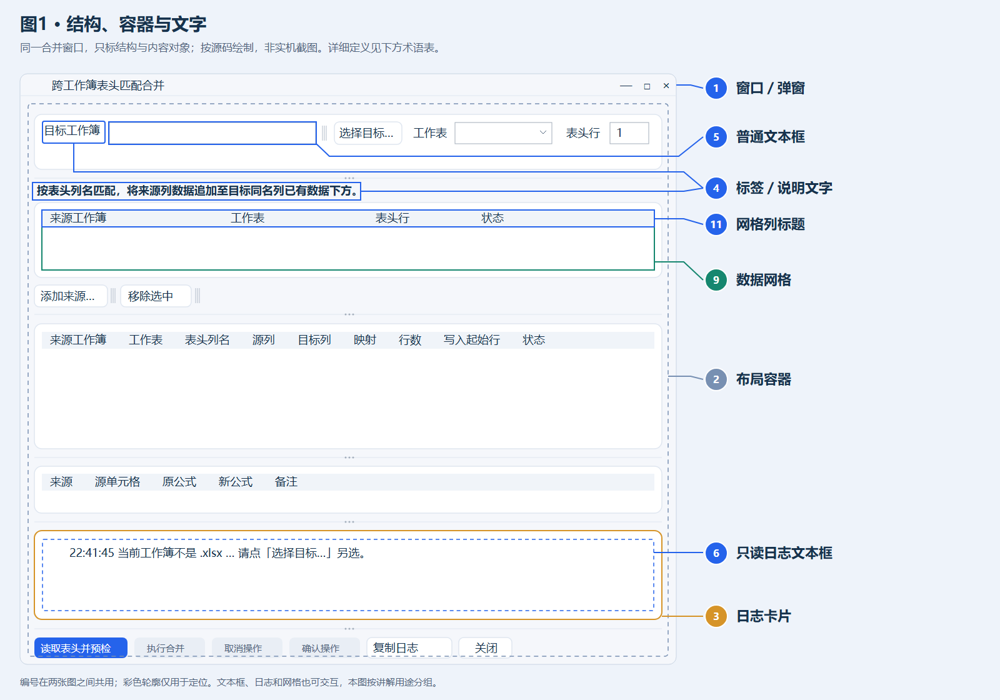
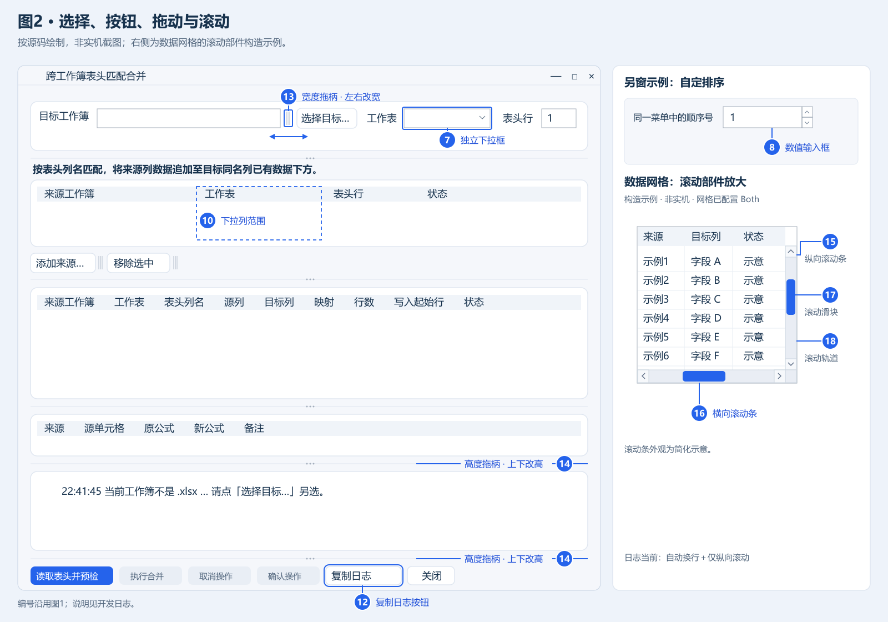
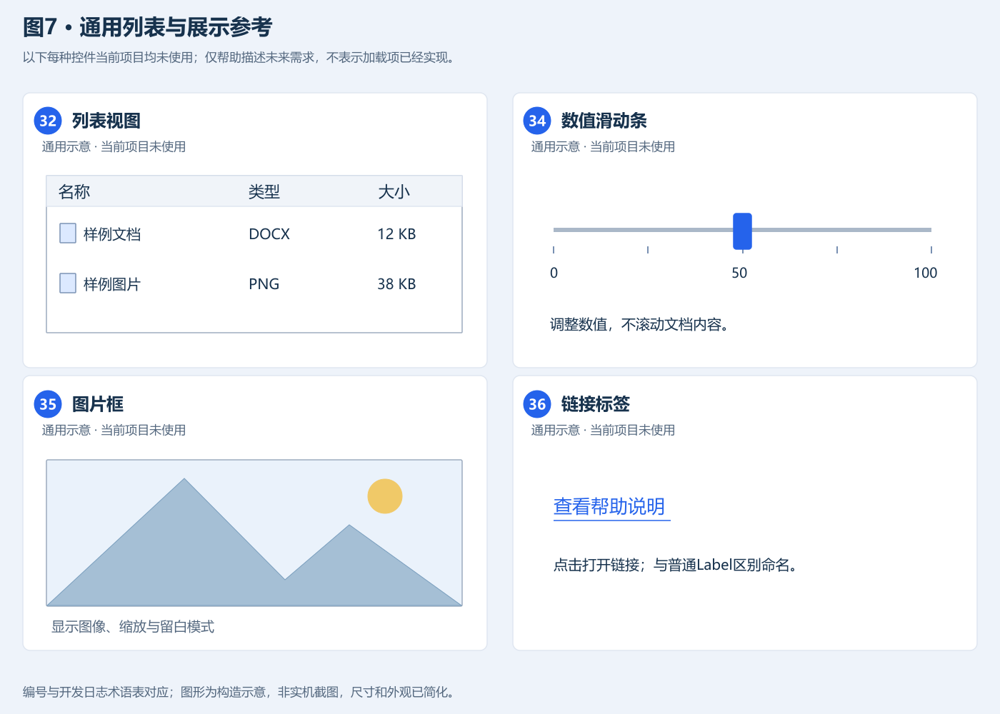

最后更新：2026-10-18 ｜ 当前版本：**0.9.9.1** ｜ 交付物：`WordUpdater_Setup.exe`

# 一. Agent及开发者接手概览

<!-- agent-overview:start -->

WPS表格VSTO加载项：引用/从属追踪、公式、筛选、链接、目录、文件整理/命名、文件名称/OCR、表头匹配合并及合并抵消。本日志按项目档案、Word/Excel共享开发经验、共享维护纪律、本宿主专属经验组织。先读AP3-说明/AGENTS.md与本日志，再核使用说明和当前源码；主选项卡的“扩展→Agent扩展”显示Agent-Evo，提供概览/全文、网站和自定配置。版本0.9.9.1，构建不安装或操作用户WPS。

<!-- agent-overview:end -->

## 1. 目录与阅读顺序

| 所属部分                                                          | 二级主题与阅读入口                                                                                                                                                                                                                                                                                                                |
| ------------------------------------------------------------- | ------------------------------------------------------------------------------------------------------------------------------------------------------------------------------------------------------------------------------------------------------------------------------------------------------------------------ |
| [项目档案](#二-项目档案)                                               | [定位/输出](#1-定位与输出)、[版本摘要](#2-版本摘要)、[命令按钮](#3-当前命令按钮概览)、[源码/运行入口](#4-源码地图与运行入口)、[当前状态/交付](#5-当前状态与交付)                                                                                                                                                                                                                      |
| [共享开发经验](#三-word与excel共享开发经验)                                 | [从零构建](#1-从零构建加载项)、[按钮/图标/菜单](#2-功能区按钮图标与菜单)、[弹窗/控件/网格](#3-弹窗美工控件与网格)                                                                                                                                                                                                                                                    |
| 共享开发经验（续）                                                     | [线程/寿命/预览](#4-宿主线程窗口寿命与安全预览)、[四种拖动/生效](#5-四种拖动及配置生效)、[Agent/文档/网站](#6-agent-evo内嵌文档与网站)                                                                                                                                                                                                                                  |
| [共享维护纪律](#四-word与excel共享维护纪律)                                 | [写作/编号](#1-文档编号与经验更新)、[重建/签名/交付](#2-重建签名与交付)、[验证/缓存/证据](#3-验证缓存与证据边界)、[冗余清理](#4-冗余文件清理)、[格式维护](#5-格式维护规范)                                                                                                                                                                                                                |
| [本项目经验](../../C-01-ExcelIterate/AP3-说明/开发日志.md#五-excel专属开发经验) | [单元格/选区/公式](../../C-01-ExcelIterate/AP3-说明/开发日志.md#1-单元格选区与公式)、[工作簿/目录/表头合并](../../C-01-ExcelIterate/AP3-说明/开发日志.md#2-工作簿目录与表头匹配合并)、[链接/文件批次](../../C-01-ExcelIterate/AP3-说明/开发日志.md#3-外部链接与文件批次)、[文件名/OCR](../../C-01-ExcelIterate/AP3-说明/开发日志.md#4-文件提取名称与云端ocr)、[合并抵消](../../C-01-ExcelIterate/AP3-说明/开发日志.md#5-合并抵消) |
| 使用者与其他入口                                                      | [使用说明](使用说明.md)、[AGENTS](AGENTS.md)、[网站日志](../../C-03-Website·Xycabin/AP3-说明/开发日志.md)                                                                                                                                                                                                                                    |

# 二. 项目档案

## 1. 定位与输出

WPS文字VSTO加载项：逐格链接Excel、更新/查看链接及选择正文顶层表格。曾用名WpsLinkUpdater，仅迁移自身旧身份。命名空间/程序集 `WordUpdater`，唯一安装器[AP1-程序/WordUpdater\_Setup.exe](../AP1-程序/WordUpdater_Setup.exe)，内嵌五载荷；用户需完整VSTO运行库及官方授权。Agent-Evo同一DLL提供网站、离线文档、四项自定配置和需求记录，实验OCR占位灰色。

AP1-程序放配置/批处理/正式程序，AP2-美工放当前PNG，AP3-说明仅本日志、使用说明和AGENTS；build是工具、中间产物和验证证据。C-01/C-02各保留完整公共源码，C-03是网站唯一源码及联合交付入口，不建立网站副本。

## 2. 版本摘要

版本来源与归并规则见[维护纪律](#1-文档编号与经验更新)，本次标记为0.9.9.1并沿用原固定发布者。

| 版本      | 重要变更                                                                                                                           |
| ------- | ------------------------------------------------------------------------------------------------------------------------------ |
| 0.9.5.0 | 1. 首次提供WPS文字加载项，支持链接Excel数据；2. 采用VSTO构建，提供单文件安装包。                                                                              |
| 0.9.6.0 | 1. 完善Excel链接、数据更新与查看功能；2. 统一窗口和图标；3. 增加运行库检查与固定证书签名，提升安装可靠性。                                                                   |
| 0.9.7.0 | 1. 按操作流程整理链接菜单，区分操作与反馈入口；2. 新增Agent-Evo选项卡；3. 支持离线阅读开发、使用文档及访问网站。                                                              |
| 0.9.8.0 | 1. 完善链接建立、更新和查看；2. Agent-Evo提供离线开发/用户预览、全文应用选择和树形尺寸设置；3. XyCabin统一指南、离线下载、音乐和独立音量；4. 规范交付、文档与清理流程。                             |
| 0.9.9.0 | 1. Agent-Evo同步排序、改名及控件缩放；2. 名称排序即时、格式尺寸下次开窗生效；3. 独立STA预览、窗口快照和需求记录；4. 通用确认隔离并完善Owner校验；5. 开发全文口令验证及离线配图缓存；6. 网格表头完整单行、居中且默认加粗。 |
| 0.9.9.1 | 1. 随联合交付重新打包，同步版本号与内嵌文档；2. WordUpdater 自身功能无变更。 |

## 3. 当前命令按钮概览

本表以当前生成的功能区 XML 现状为准，逐行列出全部顶层命令按钮及菜单子项，唯一数据源为 `AP1-程序/Configure_program.py` 的 `BUTTONS` 与 `EXTRA_TABS`；按钮、菜单或网址调整后须同步本表，Agent-Evo 为默认隐藏页，命令名称与顺序以用户自定配置为准。

| 命令按钮    | 选项卡与分组         | 子选项                                                                                                         | 功能摘要                                       | 实现来源                                                                                                                                               |
| ------- | -------------- | ----------------------------------------------------------------------------------------------------------- | ------------------------------------------ | -------------------------------------------------------------------------------------------------------------------------------------------------- |
| 更新链接    | WordUpdater·链接 | —                                                                                                           | 一键批量更新所选范围内的全部链接                           | OnUpdateLinks（Connect.cs:236）→ UpdateEngine.cs                                                                                                     |
| 链接Excel | WordUpdater·链接 | —                                                                                                           | 把复制的单元格区域逐格链接到你选中的表格区域                     | OnLinkToExcel（Connect.cs:498）→ LinkPasteEngine.cs                                                                                                  |
| 查看链接    | WordUpdater·链接 | —                                                                                                           | 查看本文档引用了哪些Excel文件及其工作表/区域                  | OnViewLinks（Connect.cs:319）→ LinkViewForm.cs + LinkViewEngine.cs                                                                                   |
| 全选表格    | WordUpdater·操作 | —                                                                                                           | 选中本文档中的全部表格（正文不受影响）                        | OnSelectAllTables（Connect.cs:396）→ TableSelectEngine.cs                                                                                            |
| 问题反馈    | WordUpdater·反馈 | —                                                                                                           | 有BUG或新增功能请发送邮箱（打开 QQ 邮箱网页版）                | OnOpenUrl_btnFeedback（Connect.cs:170）                                                                                                              |
| Agent扩展 | WordUpdater·扩展 | —                                                                                                           | 显示或隐藏 Agent-Evo 选项卡（开关）                    | OnToggleAgentExtension（Connect.Agent.cs:131）                                                                                                       |
| 调用API   | Agent-Evo·详情   | 智能云-API（百度智能云、阿里智能云）、Agent-API（国内Agent：WorkBuddy、TRAE、Qoder、DeepSeek、豆包、Kimi；国外Agent：ChatGPT、Claude、Gemini） | 四级嵌套菜单，打开对应云控制台或 AI 网站（无 screentip，url 按钮） | OnOpenUrl_btnAgentXxx×9 与 OnOpenUrl_btnAgentBaidu/Aliyun（Connect.Agent.cs）→ RibbonConfig.GetUrl 字典                                                 |
| 开发流程    | Agent-Evo·详情   | 开发预览、用户预览、XyCabin                                                                                           | 打开内嵌开发/用户文档与网站首页                           | OnOpenAgentReadme/OnOpenAgentUserGuide（Connect.Agent.cs:154/155）→ AgentDocumentForm.cs；OnAgentHome（Connect.Agent.cs:161）→ AgentLocalFiles.cs       |
| 自定配置    | Agent-Evo·操作   | 自定排序、自定名称、自定格式、交互弹窗                                                                                         | Agent 弹窗的自定义项                              | OnAgentSort/Names/Formats（Connect.Customization.cs:16-18）→ AgentCustomization.cs；OnOpenAgentDialogSizes（Connect.Agent.cs:147）→ DialogSizeEditor.cs |
| 实验计划    | Agent-Evo·操作   | OCR识别（置灰占位，未开放）、需求记录                                                                                        | 实验性功能入口                                    | OnAgentOcrPlaceholder（Connect.Customization.cs:20，空实现）；OnAgentRequirements（Connect.Customization.cs:19）→ AgentCustomization.cs                     |

## 4. 源码地图与运行入口

| 子系统        | 当前入口（未加目录者均在src/addin）                                                                                                                      |
| ---------- | ------------------------------------------------------------------------------------------------------------------------------------------- |
| 身份/生成      | project.json、project_support.py、AP1-程序/Configure_program.py、src/configuration/configure_core.py                                             |
| 加载/界面      | ThisAddIn、Connect及分部、Ribbon.g、InteropDefs、UiKit、HostDialogService                                                                           |
| Agent/自定配置 | Connect.Agent/Customization、AgentDocumentForm/LocalFiles、AgentCustomization、DialogFormatting、FormatEditorThread/Session、CustomizationSaving |
| 尺寸/预览      | DialogSizes、DialogSizeEditor、DialogPreviewFactory；src/tools/dialog_catalog_probe与DialogSizesProbe                                           |
| LINK/选区    | LinkPasteGeometry/Engine、EtSelectionReader、TableSelectEngine                                                                                |
| 更新/查看/清理   | UpdateEngine、LinkViewEngine/Form、FlashHighlighter、EtCleanup                                                                                 |
| 构建/安装      | build/rebuild/resign/gen_manifest/build_installer/verify_package/validate.py；src/installer及src/tools                                        |
| 验证/网站      | src/testharness、src/tools；同级Website完整源码与父verify_shared.py                                                                                   |


单项目：`python rebuild.py --mode full` 后 `python validate.py --background`。联合文档/网页交付：Website `python rebuild.py --background --mode full`，随后 `python validate.py --background`。用已实际--version验证的解释器；新设备从[从零流程](#1-从零构建加载项)开始。

## 5. 当前状态与交付

### (1). 当前实现与待验收

本次将文档整理为五部分，共享方法与维护纪律分开，删重复流水和外部历史范例依赖；保留宿主独有算法/恢复边界，修正控件与四种拖动术语、窗口过度因果和内嵌网页一致性表述。已审阅Excel专属合并、OCR与文件批次，只同步界面/维护方法，不移植工作表业务。

原命令ID、用户设置格式、程序集与安装路径沿用。名称/排序即刻刷新；格式/控件/窗口尺寸下次开窗生效，旧窗口保留快照。共享确认隔离、字体所有权与安全预览方法见第三章，不将后台通过认作真实WPS键入/菜单/焦点问题已解决。本轮安装、宿主点击和云端调用单独验收。
<!-- delivery-audit:start -->
### (2). 本轮交付证据

10月17日本批沿用0.9.9.0及原固定证书。C-02侧本轮仅同步C-01的共享文件与共享块（src/addin/UiKit.cs、MergeHeadersHost.cs、EliminationHost.cs 及开发日志共享经验/纪律块），未重新打包WordUpdater安装器；产物沿用上轮正式包，字节与SHA-256如下表，与[同批交付记录](../../C-03-Website·Xycabin/build/format-maintenance-reorg-20261014/joint-current-delivery.json)核对。

| 正式产物                                                                          |        字节 | SHA-256                                                          |
| ----------------------------------------------------------------------------- | --------: | ---------------------------------------------------------------- |
| [WordUpdater\_Setup.exe](../../C-02-WordUpdater/AP1-程序/WordUpdater_Setup.exe) | 3,322,880 | e9fa8d5c62df00aae425aaa2b47e642daafbf1bf3a86b19c7d7e762592760ec1 |

| 本批检查   | 结果与证据                                                                                                                                                                                                                                 |
| ------ | ------------------------------------------------------------------------------------------------------------------------------------------------------------------------------------------------------------------------------------- |
| 共享一致性  | 两份开发日志共享经验/纪律块逐字一致、62个共享源码文件一致；verify_shared 与两项目 devlog_probe 均通过。共享块按C-01同步：删「3. 验证、缓存与证据边界」的(1)(2)(4)三节并重编号(3)→(1)、(5)→(2)；(2). 程序所新生成工作表的格式规范按「格式维护」样张重写（首行SUBTOTAL、#4874CB表头、Times New Roman 11、会计格式含千分位、medium+slantDashDot边框）。 |
| 纪律守卫   | 新增 DisciplineProbe（C-01）：源码扫描断言「写入后必套样式」「交互弹窗禁 TopMost/工具窗样式」；两项目 EliminationProbe/Feature099 等离线回归通过。                                                                                                                                |
| 真实验收边界 | 未使用computer-use、未自动安装或启动/退出WPS、未调用真实云端OCR；共享块文字变化不影响Word侧既有功能，真实WPS交互仍单独待验收。                                                                                                                                                          |
<!-- delivery-audit:end -->

<!-- shared-wps-experience:start -->
# 三. Word与Excel共享开发经验

本章与第四章在两加载项逐字相同。共享的是加载、界面、配置和交付方法；Word字段与表格、Excel单元格与工作簿算法分别见第五章。网站前端方法只维护于[网站日志](../../C-03-Website·Xycabin/AP3-说明/开发日志.md)。

## 1. 从零构建加载项

### (1). 环境与必要输入

底座为 Windows、WPS VSTO、.NET Framework 4.8，Python 至少3.10驱动 `%SystemRoot%/Microsoft.NET/Framework64/v4.0.30319/csc.exe`，语法上限 C# 5。先实际执行 Python `--version`；子进程使用 `sys.executable`、参数列表和 UTF-8，路径由脚本位置定位，允许中文、空格和中点。

| 输入                                                                                                               | 最小职责                               |
| ---------------------------------------------------------------------------------------------------------------- | ---------------------------------- |
| project.json、AP1-程序/Configure_program.py                                                                         | 宿主/身份/sources/tools与唯一界面、版本、固定证书配置 |
| src/addin/ThisAddIn.cs、Connect.cs、InteropDefs.cs、AssemblyInfo.cs                                                 | VSTO入口、专属回调、COM声明、程序集GUID          |
| src/addin/UiKit.cs、HostDialogService.cs及所依赖公共源码                                                                  | 界面、宿主确认隔离；依赖以实际sources和工具清单为准      |
| src/configuration、project_support.py、build/rebuild/resign/gen_manifest/build_installer/verify_package/validate脚本 | 生成、编译、签名、打包与验证；文件名中的斜线表示各独立脚本      |
| src/installer、src/tools及业务探针                                                                                     | 安装流程、证书/清单工具、产品身份与行为检查             |
| lib、icons、三个AP输出目录                                                                                               | 六个编译引用、源图标、程序/美工/说明分区              |
| 完整同级Website、适用的父目录verify_shared.py                                                                               | 当前网站快照和公共副本检查；不使用旧build或历史范例补齐输入   |

六个lib为 Tools、Common、Common.v4.0.Utilities、对应Word/Excel宿主库、VSTO Runtime、Office.Core。Utilities与Office.Core随包分发；用户机仍须安装完整VSTO Runtime。公共文件选择以 `verify_shared.py` 的 SHARED_FILES 和当前编译依赖闭包为准，不按历史数量复制全部业务。

### (2). 先隔离产品身份

| 项目项                    | WordUpdater                                              | Excel-Iterate                                                |
| ---------------------- | -------------------------------------------------------- | ------------------------------------------------------------ |
| 程序集/命名空间/addin_key     | WordUpdater                                              | Excel_Iterate                                                |
| 现有兼容探活链（非WPS验收启动策略）    | WPS.Application → KWPS.Application → Word.Application    | KET.Application → et.Application → Excel.Application         |
| 探活对象/工厂/编译宿主库          | Documents / Word.ApplicationFactory / Word.dll           | Workbooks / Excel.ApplicationFactory / Excel.dll             |
| 清单host / HKCU Office挂载 | Word / Software\Microsoft\Office\Word\Addins\WordUpdater | Excel / Software\Microsoft\Office\Excel\Addins\Excel_Iterate |
| HKCU Kingsoft白名单       | Software\Kingsoft\Office\WPS\AddinsWL                    | Software\Kingsoft\Office\ET\AddinsWL                         |
| legacy_name            | WpsLinkUpdater（仅自身旧名）                                    | 空                                                            |

新产品先确定合法程序集/命名空间、显示名、host/whitelist_host、ProgID、GUID、版本及独立发布者，再同步 project.json、配置、手写入口/安装器/日志、窗口登记和探针断言。新产品 legacy_name 留空，存储/挂载/安装目录按程序集隔离；网站产品映射按产品身份区分，不能因宿主同为Excel而套用本产品版本。

ThisAddIn使用 `[StartupObject(0)]`、FullTrust，继承 `Microsoft.Office.Tools.AddInBase`，接收对应宿主ApplicationFactory与IServiceProvider，重写CreateRibbonExtensibilityObject。主DLL不做强名称签名，应用/部署清单另签。AddinsWL登记“值名=addin_key、数据=空字符串”，只登记对应宿主，不建立同名子键。

### (3). 用最小功能建立闭环

按“环境可执行→身份/必要文件齐全→一个信息按钮与只读信息窗→纯模型/回调检查→编译签名打包→安装与宿主点击”推进，随后增加菜单、Agent和业务。Engine负责运算/提交，Form只收集显示；先测正常、空态及异常，再增加下一层功能。

每次新增源码/探针同步 project.json 的 sources/tools、退出清理及产品断言。生成文件由配置/构建产生，不手改 `.g.cs`。发现旧命名空间、缺窗口映射、未知目录或错网站产品时按身份表修正，不以旧产品PASS证明新产品已受检。

首次全新产品发布者由 src/tools/MakeCertCapi.cs独立编译生成，所需引用取project_support.CSC/COMMON_REF和write_project_info；先确认唯一配置可导入且固定指纹为空，再显式运行工具，核对CurrentUser/My中的主题、有效期和HasPrivateKey，回填准确指纹并保留私钥。失败先查是否已创建，避免重复建证书。已有产品只导入原证书及私钥，绝不静默换发布者；公开.cer不能用于签名。

## 2. 功能区按钮、图标与菜单

### (1). 配置与接线

普通按钮使用全局唯一稳定ID、专属public回调和 `GetImage_<ID>`；网址叶子由生成器建立 `OnOpenUrl_<ID>`。不要按显示文案或WPS代理control.Id分派。配置器检查Connect.cs及Connect.*.cs；业务源文件必须在sources内。

最小配置如下，保留产品自身的版本、证书和生成器导入/bind/main部分；两个回调在Connect分部类实现，图片包装调用本产品现有图片入口：

```python
BUTTONS = [{
    "id": "btnInfo", "group": ("grpInfo", "信息"),
    "label": "项目信息", "size": "normal", "builtin_icon": "document",
    "action": "feature", "callback": "OnShowInfo"
}]
```

```csharp
public void OnShowInfo(object control)
{ UiDialog.Show("加载项已连接。", "项目信息", MessageBoxButtons.OK, MessageBoxIcon.Information); }
public IPictureDisp GetImage_btnInfo(object control)
{ return GetButtonImageCore("btnInfo"); }
```

父菜单仅展开，使用type=menu与children，没有action/callback/url；group和size只在根层，后代继承分组且不生成size。同层按配置顺序，最多8层；隐藏父项连同后代隐藏，空菜单不生成。root normal优先用原生三行；column仅将同组连续normal根项装入vertical box，不能跨组、断续或用于large/后代。

新增功能完成顺序：定义输入输出及取消/失败边界→Engine/Form→唯一配置→Connect接线→sources/tools/退出清理→配置与XML/回调/资源检查→重建→用户安装点击。展开、悬停、Esc不执行叶子业务。

### (2). 图标与绘制

自定义图标优先，空值或字符串None回退内置；编译时Base64内嵌，运行不读取影子缓存旁文件。根large为32、normal与后代16逻辑像素；large上图下文、normal横排。不用空格、无效Ribbon属性或伪造文字颜色调整布局。

IPicture宽高是HIMETRIC，乘96/2540才得逻辑像素；DPI/OLE首次映射可能缓存。RibbonImages用临时32位图实测，并按目标/实测比例校准，内置/自定义共用，误差最多1逻辑像素、最多重校准一次，再失败记录后回退，不改变宿主DPI。成功转交HBITMAP由OLE管理，失败DeleteObject；不释放宿主已取得或缓存的图片。

32画布主体约24～28并保留安全边距；内置垫白、自定义按配置底色合成24bpp兼容WPS alpha。窗口图标单独生成16/32透明ICO并由窗口释放。悬停文案按中文2/半角1折行、XML转义；结果模板按ID，仍补充真实失败和清理结果。

## 3. 弹窗美工、控件与网格


### (1). 先确定容器，再确定数据控件

本节是常见对象的实用参考，不穷举全部控件。编号1—27以项目实际窗口和源码为依据，28—36为“当前项目未使用”的通用示意；图3—5的局部来自不同窗口。按窗口名称、区域用途、对象及修改范围描述需求，图中轮廓仅用于定位。

**图1：结构、容器与文字。** 关注容器层级及内容区域，特别区分外层日志卡片（3）和内部日志文本框（6）。[可编辑SVG](../src/documentation/ui-object-map.svg)。



| 准确称呼（图1编号）     | 本项目中的具体对象                                          | 实现及修改范围                                                                                |
| -------------- | -------------------------------------------------- | -------------------------------------------------------------------------------------- |
| 窗口／弹窗（1）       | 整个带标题栏的“跨工作簿表头匹配合并”窗口，类MergeHeadersForm            | Form；标题、整体大小、打开与关闭行为                                                                   |
| 布局区域／布局容器（2）   | 蓝色虚线范围对应主布局root；顶部字段组targetRow、底部按钮栏actions各有自己的布局 | TableLayoutPanel／FlowLayoutPanel；排列、间距、布局行列及区域尺寸；布局容器通常没有可见外框                          |
| 卡片／卡片容器（3）     | 底部包住日志的白色圆角框logCard；顶部目标区和三张网格也各有卡片                | UiCard；背景、圆角、边框、内边距，无阴影；实际高度需核对父布局                                                     |
| 标签／说明文字（4）     | 顶部“目标工作簿”等字段名，以及来源网格上方的操作说明hint                    | Label；文案、字号、颜色和换行                                                                      |
| 输入框／文本框（5）     | 顶部目标路径targetPath及“表头行”targetHeaderRow；后者没有数值调节按钮   | TextBox；输入内容、校验规则、宽高及可编辑状态                                                             |
| 日志文本框／日志文本区（6） | 日志卡片内部的logView，显示“22:41:45 当前工作簿不是.xlsx…”等提示       | 只读RichTextBox；文案、字号、换行、滚动、选择复制及只读状态                                                    |
| 数据网格（9）        | 上方来源网格Sources、中部匹配结果网格Map、下方公式样本网格Samples          | DataGridView；数据展示、编辑、选择及列宽、行高                                                          |
| 网格列标题／行头（11）   | 网格顶部“来源工作簿”“工作表”“表头行”等列名栏；本窗三张网格均隐藏左侧行头            | DataGridViewColumnHeaderCell／DataGridViewRowHeaderCell；标题文案、字体及尺寸；数据列中的“表头行”或“序号”不等于行头 |

**图2：选择、按钮、拖动与滚动。** 沿用图1的窗口布局；网格滚动部件另作局部放大，使用构造样例解释当前网格支持的双向滚动。数值输入框（8）来自“自定排序”另窗例子；空来源网格的下拉列（10）只标列范围。[可编辑SVG](../src/documentation/ui-interaction-map.svg)。



| 准确称呼（图2编号）      | 本项目中的具体对象                                                              | 实现及修改范围                                                    |
| --------------- | ---------------------------------------------------------------------- | ---------------------------------------------------------- |
| 独立下拉框（7）        | 顶部目标“工作表”targetSheet，Control.Name为targetSheetBox                       | ComboBox；选项、当前值、可否输入及宽度                                    |
| 数值输入框（8，另窗例子）   | “自定排序”的“同一菜单中的顺序号”number，Name为orderNumber；“自定格式”的字号size，Name为fontSize  | NumericUpDown；带数值调节按钮，可改范围、步长、精度及尺寸；合并窗的“表头行”不是此类控件        |
| 网格下拉列／下拉单元格（10） | 来源网格“工作表”列sheet；某条来源记录的row.Cells["sheet"]是下拉单元格。图中为空表，只标出列范围，尚无可见下拉单元格 | DataGridViewComboBoxColumn／Cell；明确整列或指定记录；各来源工作簿可有不同的工作表选项 |
| 按钮／命令项（12）      | 底部“复制日志”按钮CopyLog；功能区命令另写完整菜单路径，如“审计工具箱→表头匹配增加”                        | 窗内RoundedButton或Ribbon命令；文字、图标、状态、尺寸及点击动作                  |
| 宽度拖柄（13）        | 顶部目标路径输入框右侧的细竖柄；部分按钮旁也有同类竖柄                                            | WidthGrip；鼠标左右拖动，调整对应输入框或按钮宽度；竖柄的外观方向不等于拖动方向               |
| 高度拖柄（14）        | 日志卡片上方gripSamples、下方gripReport两条细横条                                    | RowGrip；鼠标上下拖动，调整父布局行高；上方同时调整公式样本区与日志区，下方只调整日志区、固定按钮栏      |
| 垂直／纵向滚动条（15）    | 图2网格放大示例右侧的竖向滚动条；日志文本框也用同类纵向滚动条浏览多行文字                                  | 改变内容的垂直可见位置，不改变卡片或文本框尺寸                                    |
| 水平／横向滚动条（16）    | 图2网格放大示例底部的横向滚动条；当前合并窗三张网格支持双向滚动，日志未启用横向滚动                             | 改变内容的水平可见位置；若为日志新增横向滚动，须说明自动换行策略                           |
| 滚动滑块（17）        | 图2放大示例中，滚动条上可拖动的小块；水平与垂直滚动条各有滑块                                        | 拖动滑块查看对应方向的内容；描述时指明所属滚动条，可提出尺寸、颜色、可见性或拖动反馈需求，并核对原生控件支持范围   |
| 滚动轨道（18）        | 图2放大示例中，供滑块移动的区域，包括滑块上下或左右两侧的空余部分                                      | 描述轨道颜色或点击轨道的滚动行为；须核对原生控件是否支持所需定制                           |

**图3：选项与网格操作。** [可编辑SVG](../src/documentation/ui-options-map.svg)。


| 准确称呼（对应图号）      | 实例或使用状态                               | 实现、修改范围及源码入口                                                                                                                                                                         |
| --------------- | ------------------------------------- | ------------------------------------------------------------------------------------------------------------------------------------------------------------------------------------ |
| 独立复选框（19）       | “自定格式”的粗体／斜体；“文件批量整理”的替换、分类等选项        | CheckBox；勾选状态、独立多选、三态和事件；[DialogFormatting.cs](../src/addin/DialogFormatting.cs)、[FileToolForms.cs](../../C-01-ExcelIterate/src/addin/FileToolForms.cs)                              |
| 网格复选列／复选单元格（20） | Excel“按列筛选”的“显示”列；明确整列或某条记录           | DataGridViewCheckBoxColumn／Cell；复选值、提交时机、只读状态；[ColumnFilterForm.cs](../../C-01-ExcelIterate/src/addin/ColumnFilterForm.cs)                                                           |
| 单选按钮／单选按钮组（21）  | Excel“链接助手”的当前工作簿、其他工作簿、其他文件夹         | RadioButton；同组互斥、默认选项、分组容器及切换事件；[LinkAssistant.cs](../../C-01-ExcelIterate/src/addin/LinkAssistant.cs)                                                                               |
| 网格按钮列／按钮单元格（27） | Excel“文件提取名称”的“候选”列；共享“交互弹窗”的“可视化调整”列 | DataGridViewButtonColumn／Cell；单元格内的命令，不等于窗外按钮；[Connect.FileNames.cs](../../C-01-ExcelIterate/src/addin/Connect.FileNames.cs)、[DialogSizeEditor.cs](../src/addin/DialogSizeEditor.cs) |

**图4：树与分区。** [可编辑SVG](../src/documentation/ui-tree-map.svg)。


| 准确称呼（对应图号）   | 实例或使用状态                        | 实现、修改范围及源码入口                                                                                                                                                           |
| ------------ | ------------------------------ | ---------------------------------------------------------------------------------------------------------------------------------------------------------------------- |
| 树形控件／树节点（22） | “自定格式”的控件树、“自定名称／自定排序”的命令树     | TreeView／TreeNode；层级、展开折叠、选中、节点身份和同父排序；六点排序柄是节点子部件；[DialogFormatting.cs](../src/addin/DialogFormatting.cs)、[AgentCustomization.cs](../src/addin/AgentCustomization.cs) |
| 分区容器／分隔条（23） | “自定格式”中formatSplit的左侧控件区和右侧预览区 | SplitContainer及其分隔条；SplitterDistance、分区最小宽度、拖动后布局；与13号独立宽度拖柄分别命名；[DialogFormatting.cs](../src/addin/DialogFormatting.cs)                                               |

**图5：反馈与临时菜单。** [可编辑SVG](../src/documentation/ui-feedback-map.svg)。


| 准确称呼（对应图号）        | 实例或使用状态                      | 实现、修改范围及源码入口                                                                                                                                                                                                                 |
| ----------------- | ---------------------------- | ---------------------------------------------------------------------------------------------------------------------------------------------------------------------------------------------------------------------------- |
| 进度条（24）           | Excel“追踪从属”的扫描进度；“追踪引用”未创建此条 | UiProgressBar／ProgressBar；进度范围、当前值、连续或不确定状态，不用于滚动内容；[TrackerForm.cs](../../C-01-ExcelIterate/src/addin/TrackerForm.cs)                                                                                                       |
| 上下文菜单／菜单项／分隔线（25） | 追踪网格的右键复制菜单，及OCR候选单元格打开的菜单   | ContextMenuStrip／ToolStripMenuItem／ToolStripSeparator；出现位置、命令、启用状态、分组与关闭释放；[TrackerForm.cs](../../C-01-ExcelIterate/src/addin/TrackerForm.cs)、[Connect.FileNames.cs](../../C-01-ExcelIterate/src/addin/Connect.FileNames.cs) |
| 悬浮提示（26）          | 合并窗按钮的说明；Word“查看链接”的摘要全文提示   | ToolTip或网格单元格提示；提示文案、关联控件、显示时机及释放；[MergeHeadersForm.cs](../../C-01-ExcelIterate/src/addin/MergeHeadersForm.cs)、[LinkViewForm.cs](../../C-02-WordUpdater/src/addin/LinkViewForm.cs)                                           |

**图6：通用选择与输入参考。** [可编辑SVG](../src/documentation/ui-common-input-map.svg)。


| 准确称呼（对应图号）   | 实例或使用状态         | 实现、修改范围及源码入口                                                |
| ------------ | --------------- | ----------------------------------------------------------- |
| 选项卡／选项页（28）  | 当前项目未使用；图6为通用示意 | TabControl／TabPage；页签、选中页、切换与页面内容；不同于WPS功能区选项卡或网格中的“选项卡归属”列 |
| 分组框（29）      | 当前项目未使用；图6为通用示意 | GroupBox；带标题的分组边框及内部控件；不同于3号UiCard                          |
| 列表框（30）      | 当前项目未使用；图6为通用示意 | ListBox；选项集合、选中项、多选和滚动；不同于数据网格                              |
| 勾选列表框（31）    | 当前项目未使用；图6为通用示意 | CheckedListBox；列表项的勾选与选中分别说明；不同于20号网格复选列                    |
| 日期／时间选择器（33） | 当前项目未使用；图6为通用示意 | DateTimePicker；日期／时间值、范围、显示格式及日历选择；不同于普通文本框                 |

**图7：通用列表与展示参考。** [可编辑SVG](../src/documentation/ui-common-display-map.svg)。



| 准确称呼（对应图号） | 实例或使用状态         | 实现、修改范围及源码入口                                       |
| ---------- | --------------- | -------------------------------------------------- |
| 列表视图（32）   | 当前项目未使用；图7为通用示意 | ListView；列表／图标／详细信息视图、项与子项、选择和排序；不同于9号DataGridView |
| 数值滑动条（34）  | 当前项目未使用；图7为通用示意 | TrackBar；范围、刻度、步长及数值；其滑块调整数值，17号滚动滑块改变可见内容位置       |
| 图片框（35）    | 当前项目未使用；图7为通用示意 | PictureBox；图像来源、缩放、居中及留白；更换图像时处理资源释放               |
| 链接标签（36）   | 当前项目未使用；图7为通用示意 | LinkLabel；可点击的文字链接、目标、访问状态和打开动作；不同于4号普通Label       |

5号文本框的变体也要按用途命名：**密码输入框**使用TextBox的UseSystemPasswordChar／PasswordChar掩码显示（例如文件提取名称的secretKey），**多行编辑框**使用Multiline并说明是否允许换行、Tab和编辑（例如需求记录的notesBody）；只读日志与可编辑需求记录分别描述。系统文件夹／文件／颜色选择器属于1号窗口的不同类型，说明其用途与返回结果，不把它们当普通输入框。

**滚动与尺寸调整要分别描述。** 滚动条用于查看更多内容，13／14号拖柄用于调整控件或区域尺寸。合并窗日志logView当前为只读RichTextBox，WordWrap=true（自动换行）、ScrollBars=Vertical（仅启用纵向滚动）；长行通过换行显示，未启用横向滚动。内容未溢出时可能看不到滚动条；图2的滚动部件用独立网格构造样例展示，未给日志增加横向滚动条。若要求左右查看完整长行，应明确提出关闭自动换行、启用双向滚动，这是新增需求，不能描述为修复已有横向滚动条。该窗口三张数据网格已配置ScrollBars.Both，网格的滚动能力不能当作日志的既有能力。

两图中的合并窗对象集中在[MergeHeadersForm.cs](../../C-01-ExcelIterate/src/addin/MergeHeadersForm.cs)：构造函数组装布局和卡片，BuildSourcesGrid配置来源列，AppendLog添加时间戳。卡片与控件外观见[UiKit.cs](../src/addin/UiKit.cs)；另窗数值控件分别见[AgentCustomization.cs](../src/addin/AgentCustomization.cs)的CommandCustomizationForm和[DialogFormatting.cs](../src/addin/DialogFormatting.cs)的DialogFormatEditor。这些源码入口供两项目共享参考，不表示Word加载项具有Excel合并业务。

典型关系为“窗口→布局容器→卡片→输入控件／日志文本框／数据网格”；仅数据网格继续区分数据行、列和单元格。布局容器也可直接放控件。TableLayoutPanel的布局行列用于排列，DataGridView的行列用于展示业务数据；界面网格单元格与宿主工作表单元格、Word文档表格单元格分别命名。“来源网格中的‘表头行’列”是输入工作表行号的数据列，“来源网格的列标题”才是顶部列名栏。涉及单条记录时用文件名、工作表名等业务身份定位，不能只靠排序后的可视行号。

宽度拖柄（图2·13）与高度拖柄（图2·14）的定位、拖动方向和作用范围见表；其他拖动对象按用途命名：**格式预览缩放手柄**位于“自定格式”右侧预览的选中控件右边、下边和右下角，调整尺寸草稿；**命令树排序拖柄**是“自定排序”树节点的六点标记，拖动节点调整同父命令顺序。这两种预览／排序手柄未出现在合并窗截图中。需求应写明位置、调整目标和是否保存重开后的结果；机制和源码入口见[四种拖动及配置生效](#5-四种拖动及配置生效)。

需求句式为：**窗口名称／菜单路径→区域位置和用途→对象及作用范围→要改的属性或动作→期望效果→生效与保存方式（需要时）**。例如：

- 外层容器：“修改‘跨工作簿表头匹配合并’弹窗底部日志卡片（图1·3）的边框颜色和内边距。”
- 内部文字：“修改同一弹窗底部日志文本框（图1·6）中‘当前工作簿不是.xlsx’这条提示的文案和字号。”时间戳格式与业务提示文案分别说明。
- 网格控件：“修改同一弹窗来源网格‘工作表’下拉列（图2·10）的选项，作用范围为所有来源记录。”若只改一条，补充对应文件名和工作表名。

**完整需求表达示例（拟新增双向滚动的需求，不代表当前已实现）：**

> 我需要你帮我修改ExcelIterate中“审计批量匹配→表头匹配增加”打开的“跨工作簿表头匹配合并”窗口。修改对象是底部日志卡片内部的日志文本框（图1编号6，源码字段logView）。
>
> 请关闭自动换行，保留日志已有的换行符，让较长的一行保持原来的行结构。文字宽度超过可视区域时，显示底部水平滚动条；日志高度超过可视区域时，显示右侧垂直滚动条。用户可以拖动对应的滚动滑块，左右查看完整长行、上下查看更多日志。
>
> 文本框保持只读，继续支持选择、复制文字及“复制日志”按钮。完成后，请分别用一条包含长路径的超长日志、多行日志和少量短提示验证：长行能左右查看，多行能上下查看，未溢出时不显示多余滚动条；并确认通过上下高度拖柄调整日志区高度后，滚动条仍正常工作。

底部日志卡片logCard是局部变量，内部logView是字段。外层处理边框、圆角和内边距；日志区高度由父TableLayoutPanel对应行及上下RowGrip调整；内层处理文字显示、换行、滚动和复制。源码变量名用于定位，不直接等同Control.Name或稳定配置ID，配置身份须核对窗口ID和注册规则。输入控件提供参数，网格展示数据与编辑状态，Engine负责业务校验和写入。

### (2). 统一视觉与布局

UiKit直接编译进加载项/安装器，无第三方UI运行库。背景#F5F7FB、白卡、边框#E4E9F2、主蓝#2563EB、从属绿#16876F及危险红；卡片圆角12、按钮8，外边距16、区间12。正文Microsoft YaHei UI 10pt、标题16pt、辅助9pt，缺字体回退。

RoundedButton不透明父色覆盖整区，禁系统默认按钮绘制，保留正常/悬停/按下/禁用/键盘焦点状态，避免黑色虚影。Ui.PrepareForm接UiWindowChrome，保留原生标题栏；Windows11支持时DWM配色，高对比度优先系统，失败不阻止开窗。标题栏字体由系统管理。

同一控件不混用手工坐标和Dock控制；短标签按真实字体测宽，长说明按实际可用宽度测高，加粗后重测。状态、说明与动作区独立，窄窗换行或滚动，主区域可选择复制；长公式放列表单元格而非无空格Label。固定坐标窗自行Arrange并按真实Bottom推进后续区域，不能布局后强盖尺寸。

### (3). 列表填充与身份

搜索只改可见行，不改勾选；全选只作用当前结果。行Tag绑定原对象/列身份，排序后提交、恢复仍按身份，特殊自身行不混入业务计数。Rows.Add首行可能在Tag赋值前触发选中事件，填完显式同步明细/按钮；右键先选鼠标所指行。

行高默认约34、表头约38，关闭EnableHeadersVisualStyles；添加行前设RowTemplate，句柄创建及格式应用后复核DPI。表头完整单行、居中且默认加粗，显式自定格式可关闭粗体；实际字体、字号、Padding和排序图标决定最小列宽与单行表头高度，不启用表头换行。短列AllCells、长列Tag存逻辑上限、末列Fill，均须先满足完整表头宽度；手动缩窄不低于该下限，窄窗横滚。文件提取名称另按正文30个“0”限宽，表头所需宽度优先，不能被局部策略或后续格式应用覆盖。DataGridViewColumn没有MaximumWidth。特殊行同时设普通/选中背景；全文提示用未受EndEllipsis限制的真实测量。规范与维护范围见[格式维护规范](#5-格式维护规范)。

保留原生Ctrl+C，扩展快捷键采用Ctrl+Shift。Clipboard.SetDataObject(text,true)支持宿主退出后粘贴，保留业务已有占用重试。界面或日志显示失败不改变已提交业务事实；诊断与用户结果分流。

## 4. 宿主线程、窗口寿命与安全预览

### (1). COM与窗口分工

宿主UI STA捕获稳定目标/快照并提交COM操作，窗口线程只收纯数据；临时COM引用用finally逐次ReleaseComObject，GetIUnknownForObject增加的引用逐次Marshal.Release，宿主传入的Application为借用引用不释放；工具自己GetActiveObject取得的引用逐次Release，也不将FinalReleaseComObject推广到共享RCW。对象持有期间按RCW/IUnknown加路径名称核对，关闭重开的同名对象不能冒充原目标。

信息/浏览/结果窗通常非模态Show，并按有效宿主同进程HWND指定Owner；同类窗单实例，重复命令刷新/激活，FormClosed只清对应实例。纯参数窗使用独立STA、Application.Run和非模态Show；宿主登记会话、明确应用后复查原目标，等待期间不占全局忙碌。卸载在所属线程关闭自有窗/字体并清引用，重复或迟到回调不写入。

Owner候选需HostDialogService.ValidateOwner核对同进程、调用线程、可见顶层窗，不能借其他应用前台句柄。保留各类窗口的合理原生样式；某个样式差异只能作为排查线索，不能断言ShowInTaskbar/MinimizeBox设置必然造成菜单故障。

### (2). 同步确认隔离

UiDialog.Show保留DialogResult/默认值与样式；宿主提示、确认经HostDialogService独立STA显示，以CoWaitForMultipleHandles原生COM感知等待，宿主不建WinForms模态循环，不调用ShowDialog/DoEvents。重入确认返回取消；只恢复本次确实禁用的Owner，预禁用保持。文件夹/OpenFiles/SaveWorkbook只传路径字符串；颜色选择留独立格式线程，安装器独立进程另处理。

取消/Esc/关闭零写入，破坏性确认不绑Enter；中断全部链接保留两次确认。若应用和取消均导致Ribbon立即收起/无法键入，查消息循环、Owner启用、焦点/捕获与释放，保留首异常证据，不直接认定算法或窗口样式是唯一根因。

### (3). 尺寸登记与真实安全预览

新增自有Form接入五处：DialogCatalog稳定ID/默认与最小96 DPI客户区→DialogSizing.Prepare→DialogPreviewFactory真实Form+固定样例→DialogTree实际Ribbon叶子映射→ThisAddIn退出清理。系统选择器、浏览器、安装器不登记。构造/Load不能自动读真实宿主或执行业务，预览注入样例并禁业务/跳转/高亮清理。

DialogSizes.xml按程序集隔离，禁止DTD、版本/范围校验、锁内摘要冲突检查和原子替换；无效值默认、未来版本只读。尺寸草稿、恢复、预览拖动关闭都需显式保存；ResizeBegin/End只捕获用户拖动，普通业务临时窗口缩放、屏幕裁剪、程序缩放不持久化。新预览沿用当前草稿。目录命令列按实际文字/缩进测宽而非Fill，点击/绘制共用坐标，窄窗横滚。

格式编辑器独立STA，ThreadLocal集合管理窗口/字体；隐藏源Form只初始化一次，停在隐藏父容器，画布仅显示不透明选择Overlay。刷新执行Apply→布局→捕获→矩形同步，不Show/Focus/反复挂接。DrawToBitmap只取源，RichTextBox用EM_FORMATRANGE补绘并释放资源，隐藏TextBox/ComboBox按真实文字/样式补绘、密码遮罩；命中与补绘共用裁剪后的同次快照。不能用空白捕获宣称用户可见。

## 5. 四种拖动及配置生效

### (1). 输入与按钮拖宽：WidthGrip

Ui.Grip将标签、控件和竖柄放入不换行FlowLayoutPanel；其他布局的floating柄跟随目标Parent/Bounds。MouseDown记录屏幕起点及原宽并Capture，移动按增量调整且限制最小宽；正常MouseUp只提交一次。捕获丢失、控件隐藏/释放取消当次拖动并恢复原宽，不保存。

提交经DialogFormatting.SaveControlWidth将宽度除DPI比例存为96 DPI逻辑像素，使用稳定窗口/控件ID写入同一Customization.xml；预览不落盘，写入失败保留本次可见宽度并记录诊断。下拉框自动测宽先尊重显式宽度，避免Load/FontChanged/选项变化覆盖用户值。Dock拉伸路径框是否加柄由实际布局决定，不写“所有窗口都有柄”。

### (2). 卡片区块改高：RowGrip

横柄调整TableLayoutPanel的上/下内容行，非固定下区时保持两行总高，上区夹在minAbove至total-minBelow、下区取剩余；总高不足两个最小值则不启动Capture或保存。固定按钮栏时只改上区。这是改区域高度，不是拖卡片换位置。起点、Capture、取消和提交纪律与WidthGrip一致；SaveRowHeight以 `窗口ID::row.xxx` 合成键记录上区逻辑高度，具体Form加载时将已存逻辑高度经Ui.Px换算到当前DPI，再检查对应空间门限并按可用空间重排；RowGrip最小高度按96逻辑像素声明，Begin与移动时经Ui.Px换成当前DPI物理高度；若移动时两个最小高度已超过原两行总高，则取消并恢复起始尺寸。真实跨屏DPI验收仍单列，不由UiCard或通用控件尺寸应用器替代。

### (3). 格式预览控件缩放：PreviewSelectionOverlay

先Register稳定Name/确定性ID及ResizeWidth/ResizeHeight能力；右、下、右下手柄分别改宽、高或二者，屏幕增量除DPI比例后更新草稿，不联动字号。MouseUp完成当次草稿，Esc/捕获丢失恢复；整个编辑器保存后才落盘。

FormatRule Width96/Height96为1～4096、0默认；ComboBox/UpDown仅宽可调，标题/表头/数字框内部子控件不另缩放。每次Apply还原原Size/MinimumSize/Dock/Anchor/AutoSize→应用文字字体→Resolve尺寸→重排测量→捕获快照。单行TextBox关闭AutoSize才能改高；超出内容由外层滚动，恢复默认尺寸只清宽高。

### (4). 命令顺序拖动：SortableCommandTree

OwnerDrawAll绘蓝色+/−与六点柄，共用Expander/Grip/TextArea/RowAt坐标，按Level/缩进/横滚/DPI计算；叶子和分支保留相同展开槽，槽→柄→文字各隔4逻辑像素，NoPadding绘文字。不用空格改变层级。

超过系统DragSize才ItemDrag，展开槽不拖；DoDragDrop的目标只限同父菜单子项，顶层不可移动。自定名称树复用布局但不显示六点。保存同父顺序而非拖动Ribbon实体按钮，旧ID保持回调/图标对应。

### (5). 名称、排序、格式、尺寸各有生效时机

RibbonCustomization从默认XML登记稳定命令，根菜单转dynamicMenu；专属GetContent/GetLabel读取最新名称/顺序，不依赖control.Id。保存先核对冲突、原子XML写入，再CustomizationSaving.AfterSave通知宿主dispatcher；宿主STA Invalidate已登记Ribbon，刷新失败不能误报未保存。

名称/顺序当前会话生效；格式、控件宽高及弹窗尺寸只影响下次打开的新窗口。FormatSession.Capture按实例固定快照，Data按摘要读取最近有效配置；已开窗不受后续保存影响。LiveCustomization监听Changed/Created/Deleted/Renamed并去抖BeginInvoke，仅名称/顺序变化刷新菜单。损坏读取保留最近有效数据，未来格式只读；两产品隔离，不重启WPS。

默认Font在登记时独立克隆，由所属窗释放；字号6～36、缺字体/样式回退，表头变化重测。取消零落盘，恢复不丢其余配置；名称/顺序保存不能覆盖格式/尺寸。

## 6. Agent-Evo、内嵌文档与网站

EXTRA_TABS预声明选项卡；主toggle的get_pressed与附加tab的get_visible读同一Visible，onLoad登记Ribbon，点击修改/刷新/原子存AgentExtension.state，失败刷新回旧状态、保存失败如实提示。默认隐藏，显示后由用户选择；新增第二附加tab须独立状态/键/刷新集合，不能只追加配置。卸载清窗与引用。

概览从开发日志/使用说明的唯一agent-overview标记提取；构建将去除delivery-audit的开发日志正文与完整使用说明以UTF-8规范换行内嵌，修改后必须重建才能更新DLL。全文每次经SHOpenWithDialog选择应用，取消保留概览、不写默认关联。AgentLocalFiles按程序集与文档／资产联合摘要释放内容包：AP3-说明中的Markdown与同级AP2-美工图片、src/documentation示意SVG保持原相对路径。WpsShared.Agent.Assets.xml记录当前文档的资源映射、大小及摘要；只导出本次请求的文档和资产，缺失／损坏缓存修复后才打开应用，保留可能在用的旧包。构建、增量缓存、文件盘点和图片门禁复用Website的document_assets收集函数，只把实际引用资源列为必要输入。

开发预览的“全文”每次由AgentDocumentAccess发起口令验证，提示“请输入开发者的微信名称”；掩码TextBox仅在当前窗口中保存输入，产品只存校验摘要，不写输入日志、不持久化授权。错误可重试，取消／Esc／关闭／异常均不导出、不选应用；用户全文、概览和复制不验证。DeveloperPasswordForm通过HostDialogService的结果型隔离接口显示，登记agent.developerpassword及其预览、尺寸和退出清理；预览构造不验证、不导出。该验证保护入口，不加密已导出的MD。正文里的业务源码、姊妹项目与历史证据链接仍是工作区定位，离线内容包只随附文档配图及示意SVG。AgentDocumentCoreProbe为无窗体后台回归入口，不把后台结果登记为真实查看器或WPS验收。

网站资源名WpsShared.Agent.Home.html固定，两DLL内嵌同一无EXE快照，独立HTML附加本轮两包；归一installer-assets后比较网页资源，不比较两个宿主DLL字节。缓存释放到LocalAppData/Xy/AgentEvo/Home/<摘要>/index.html，按http/https关联找默认浏览器，不用.html关联替代。网站配置与下载细节见Website日志。

RequirementsForm使用Requirements.txt UTF-8原子保存并查外部修改；介绍Label独立。普通关闭保存/放弃/取消，宿主退出原子保存唯一unsaved草稿，下一次选择恢复；正式保存成功后清草稿失败不能误报保存失败。预览只用固定样例，不读写用户记录。

# 四. Word与Excel共享维护纪律

## 1. 文档、编号与经验更新

AGENTS只放阅读顺序/正文链接；开发日志保存可执行方法、边界、入口和证据；使用说明保存用户步骤/结果/限制。源码文档为知识来源，不依赖旧聊天或隐藏记忆。不额外建立维护副本。

标题体系如下，最多五级，不为凑层级拆短句；同级连续编号、新父级重置子级，编号后一个半角空格。新增经验归现有主题，必要时用第五级细分，代码围栏内不参与编号：

```markdown
# 一. 标题
## 1. 标题
### (1). 标题
#### a. 标题
##### i. 标题
##### ii. 标题
```

维护顺序：对照最终源码→提炼做法/边界/入口/证据→判断共享→更新对应主题、指南/地图/目录/顶部日期→文档/锚点/共享门禁→固定正文重建→回填审计。共同经验及公共源码成对同步、逐字/字节一致；宿主算法留第五章，姊妹缺失写待同步，不声称成对通过。无新增可迁移经验如实说明，不编造根因。

版本唯一来源INSTALLER_VERSION，四段0～65534，仅用户指定才修改；两日志版本表升序，每版一行最多200字，新第三段主版本将前一主版本子版本并入末段0。安装器/加载项/清单版本同源，配置导入不生成文件/字节码，值不变不回写；网站PRODUCTS从新到旧但摘要与对应日志一致。

保持唯一agent-overview、shared-wps-experience、delivery-audit标记有序；共享区域连续包含第三、第四章，目录在概览外。devlog_probe/markdown_gate检查九份文档编号与本地标题锚点，verify_shared核对公共副本及共享块；Markdown可视化编辑器删注释后必须修复。审计只放本次产物/结果索引，不放有效开发经验，回填审计不改变内嵌正文。

## 2. 重建、签名与交付

现有单项目入口只重建自己，无--background参数：`python rebuild.py --mode full` 后 `python validate.py --background`。两产品文档/网页共同交付直接在Website运行 `python rebuild.py --background --mode full`（或其AP1批处理选2），再 `python validate.py --background`；增量选1/--mode incremental，无mode默认full。携带完整Website；两加载项均在时带父verify_shared.py。构建不安装、不结束WPS。

链路为 Configure_program.py→build.py→resign.py→build_installer.py；每次编译后必须重签，csc的新MVID会改变DLL摘要。固定证书缺失/无私钥/过期或错指纹即停，不切换发布者。安装器内嵌主DLL、Utilities、Office.Core、应用清单、部署清单共五载荷。

清单保留FullTrust/customHostSpecified/GAC与vstav3/vstov4结构；未强签DLL依赖不带token。应用清单签后读顶层identity重建vsto引用，计算的是manifest文件本身的精确大小与SHA-256 Base64摘要；UTF-8 BOM/CRLF。SignCmi采用SHA-256，两清单分别有StrongName/Authenticode签名；ValidateManifest查结构，ValidateXmlSig查整清单及license绑定。信任缺失与签名损坏分别报告，缺校验器/载荷不符阻止交付。

统一入口固定空installer-assets快照→两包暂存与后台验证→独立HTML附本轮包→核对正文/资源/包字节→事务替换两EXE、HTML和current-delivery.json。失败保留上轮正式产物，回滚未完保留恢复文件；只生成配置预览不表示完成联合发布。两个DLL的HTML资源相同，不要求DLL相同；发布后再次单独打包须重跑联合入口以恢复下载一致性。

安装需完整VSTO Runtime和官方VSTOInstaller：RuntimeLocator查HKLM两视图及Common Files，缺少先停止，不释放新载荷/写信任。用户保存文件并完全退出WPS后运行安装器，在官方窗口授权；注销本产品旧订阅成功才替换/重装，真实退出0才补Manifest、LoadBehavior=3、AddinsWL。取消/非零退出如实报告，不静默安装。卸载只清自身订阅/挂载/白名单/信任/载荷，保留LastInstallDir。

排障按“运行库→SetupLogs→五载荷/挂载/白名单/订阅信任→签名摘要→真实宿主”。Manifest是绝对file URL+|vstolocal，codebase相对；移动目录须重装。同版本不代表同字节，查安装路径与实际加载DLL摘要。COMAddIns.Connect可作连接证据，Object=null/模块扫描/文件释放不能单独定启用。SetupDoctor在build，只读诊断不随正式输出交付。

## 3. 验证、缓存与证据边界

### (1). 用COM启动、附加和验证WPS

在STA执行：表格用KET.Application并创建Workbooks.Add，文字用KWPS.Application并创建Documents.Add。只读诊断用Marshal.GetActiveObject附加现有实例，失败返回SKIP/INCOMPLETE，不启动应用；已授权需要启动时使用Type.GetTypeFromProgID加Activator.CreateInstance（PowerShell等价为New-Object -ComObject），再设置Visible并创建测试对象，不能只打开WPS首页。附加模式只限定不启动宿主，不自动使业务只读；只读诊断不创建或修改文档。以下为现有.NET Framework 4.8探针中ProbeSession的开窗接线示例，外围Main标记[STAThread]，捕获异常并用session.Finish记录结果；它不包含具体业务验收断言。PowerShell直接调用Marshal.GetActiveObject应使用Windows PowerShell 5.1，PowerShell 7须采用适用的ROT/原生接口实现。

```csharp
bool isSheet = true;                         // false：WPS文字
bool attachOnly = true;                      // 显式启动时才改为false
string progId = isSheet ? "KET.Application" : "KWPS.Application";
dynamic app = session.Take(ProbeSession.Connect(new[] { progId }, attachOnly));
if (app == null) return session.Finish(2);
string exe = Path.Combine(Convert.ToString(app.Path), isSheet ? "et.exe" : "wps.exe");
FileVersionInfo info = FileVersionInfo.GetVersionInfo(exe);
if ((info.ProductName ?? "").IndexOf("WPS", StringComparison.OrdinalIgnoreCase) < 0)
    throw new InvalidOperationException("无法确认WPS宿主，停止写入。");
session.Override(() => (object)app.Visible, v => app.Visible = v, true, "Visible");
dynamic items = session.Take(isSheet ? (object)app.Workbooks : (object)app.Documents);
object sample = items.Add();
session.Own(sample, delegate {
    if (isSheet) ((dynamic)sample).Close(false); else ((dynamic)sample).Close(0);
});
// 仅对sample及独立临时目录执行写入、保存、读回和恢复断言；不操作用户文档。
return session.Finish(2);                    // 仅演示开窗；补齐业务断言后才可返回0
```

注册映射和进程核对另按上节执行；示例中的文件产品检查不能代替完整身份记录。ProgID不存在、指向不符、未发现现有实例或身份不足时明确失败/未完成；以WPS为目标的验收不静默改用Excel.Application/Word.Application。现有业务探针的兼容回退链不是严格WPS启动契约，运行前须核对实际连接；附加失败可检查ROT文件moniker，但只能选择明确的测试文件，不能任取第一个文档。GetActiveObject也不保证拿到用户眼前那个窗口，目标用实际文档/工作簿身份确认。

CreateInstance可能复用已有Application，不能据此认领或Quit宿主。仅关闭自己创建并持有的测试文档/簿；所有自取COM属性/集合/范围逐次登记并ReleaseComObject，避免链式访问产生遗漏，不FinalRelease共享RCW。读取原值成功后才临时设置Visible、DisplayAlerts、ScreenUpdating、EnableEvents等，并在finally恢复；无法读取则不改。原文档Saved只观察，不设true掩盖修改；按需恢复原活动文档/簿、选区和剪贴板。失败返回非零并保留样本及日志，不按全局新增PID退出或强杀进程。实现入口为两项目src/tools/LiveProbeSafety.cs及对应实机探针。

COM可验证真实宿主中的业务读写、字段/公式、保存与还原；不能代替按钮点击、键入焦点、弹窗外观、鼠标拖动及实际跨屏DPI验收。COMAddIns.Connect仅说明连接状态；本项目未提供COMAddIns.Object自动化桥，Object=null须记INCOMPLETE，不能用新建Connect实例冒充已加载Ribbon回调。COM/API检查不需要computer-use；可见交互尚未执行时保留人工待验收状态。启动与附加API区别参见[New-Object](https://learn.microsoft.com/en-us/powershell/module/microsoft.powershell.utility/new-object)、[GetActiveObject](https://learn.microsoft.com/en-us/dotnet/fundamentals/runtime-libraries/system-runtime-interopservices-marshal-getactiveobject)。

### (2). 弹窗维护规范

交互弹窗设错窗口样式会把宿主锁死：弹窗打开后无法在单元格键入、点不开有子选项的功能区菜单，而宿主窗口 enabled 仍为 True、宿主线程仍活着（功能区主按钮可反复点击），极易误判为宿主被禁用或线程阻塞。真根因是工具窗样式：设 `ShowInTaskbar = false`、`MinimizeBox = false` 会加上 WS_EX_TOOLWINDOW，无主非模态 tool 窗在 WPS 宿主线程上抢焦点/失激活——前台被弹窗把持，键盘输入进不了文档、功能区下拉点不开，宿主 enabled 与线程状态都不受影响，表现为“假死”。曾两度误判：先删无主窗的 TopMost，再把 Load 内业务 BeginInvoke 异步化，均未生效；按打开前后 enabled 均 True 排除宿主被禁用、功能区主按钮可反复点排除线程阻塞、前台窗口=弹窗指向激活/焦点问题三重排除后，才锁定与链接助手等正常弹窗的样式差异。Word 与 Excel 两侧的交互弹窗都按本节构建。

正确构建交互弹窗：不设 `ShowInTaskbar = false`、`MinimizeBox = false`（即不引入 WS_EX_TOOLWINDOW），不重写 ShowWithoutActivation，不向无主窗设 TopMost，与链接助手等既有正常弹窗保持同套默认样式；非模态显示统一 `IntPtr owner = GetHostWindowHandle(); if (owner == IntPtr.Zero) form.Show(); else form.Show(new WindowWrapper(owner));`，WPS 回调线程上 owner 校验常不成立、取到 0 时走普通 Show 即可，样式正确即不锁死，不为拿 owner 改样式；Load 只做界面装配，重业务移出 Show 栈（BeginInvoke 到消息泵 idle），内置打开前后 enabled/前台/owner 诊断日志，复发时按三重排除定位，不再次误判；新弹窗在 DialogSizes、DialogPreviewFactory、dialog_catalog_probe、GridHeadersProbe 登记尺寸与目录，探针补源码守卫（禁 TopMost=true 与工具窗样式）和预览构造断言（ShowInTaskbar/MinimizeBox 保持默认 true），把根因钉进门禁；验收必须含真实宿主交互：开窗后键入单元格、展开功能区子菜单、Esc 关闭，后台探针通过不等于焦点与菜单验收。

## 4. 冗余文件清理

只有用户实际要求“启动冗余清理”才触发盘点/删除；讨论规则、改文档或构建不触发历史清理。默认范围三个项目，另指定从其指令；项目外原图、用户配置/缓存不自动纳入。

冗余候选须同时满足：生命周期结束/有有效再生办法；不在现行依赖闭包（含动态加载、资源、文档/证据引用）；独有经验/恢复信息已归并；隔离排除候选后从保留输入无旧build重建和适用验证通过。旧日期、old/backup文件名、build目录或搜不到引用都不足以证明可删。

分五类盘点：必要输入、当前产物、有效证据、可删历史、未确认。按实际字节从大到小核对用途/摘要，公共副本职责不同不能因同SHA删除；移动项目内不算释放。私钥/必要依赖/未完成恢复资料始终保护，.cer和公共CA .pem不按扩展名误作私钥。

执行顺序：记录范围/版本/用途/数量/字节/摘要→归并经验修引用→隔离排除候选完成重建/签名/载荷/资源验证→Website `src/tools/cleanup.py --dry-run`生成schema 3五类清单→逐项审阅→`--apply`读同一清单复查→复核正式产物/链接并报告实际删除/失败/保留及字节差。清单后的输入/目标变化须重新盘点。

fixture-state必须真实结束；cleanup-review绑定源码指纹、逐文件摘要、用途/经验结论、隔离成功证据及原日志摘要，禁止伪造状态。删除前核绝对路径在指定项目内，不删项目根、不跟随联接、不碰项目外文件；不完整恢复保留。已授权确认项按范围执行。探针成功仅释放自建临时文件，失败保留诊断与恢复资料。

## 5. 格式维护规范

### (1). 弹窗中数据网格的格式规范

#### a. 格式规范说明

##### i. 表头格式规范

所有新增及现有生产弹窗的数据网格表头完整单行显示、居中、默认加粗。用户在“自定格式”中明确关闭粗体时尊重其选择；字号、字体、颜色和表头文字仍可自定，不能因此开启换行或截断表头。单行表头高度随实际字体、字号和DPI重新测量，避免上下裁剪；正文样式、网格稳定身份和已有用户配置保持，不通过重置配置取得默认外观。


上图来自“设置OCR前缀”的离线生产控件渲染，展示完整、单行、居中加粗的表头；非真实WPS截图，不作为宿主交互验收证据。

##### ii. 列宽与正文显示规范

列宽下限按当前实际表头字体、文字、内边距和排序图标测量，包含Fill列、复选列、下拉列与按钮列。手动缩窄不得低于完整表头宽度；宽度总和超过窗口时通过横向滚动查看，不压缩或换行表头。

文件提取名称正文自动适配上限仍为当前字体30个“0”加内边距，通常下限50逻辑像素，完整表头需要更宽时优先。该上限不裁剪数据、不限制手动调宽。新扫描重启适配周期；本周期后续重试、核对、规则调整与窗口缩放尊重已手调列宽。

#### b. 代码复现方法

源码链接在完整项目目录中使用；加载项离线全文保留下列片段，不携带业务源码。完整实现以链接中的函数为准；在同一加载项源码程序集内复用现有内部类型，修改公共网格代码后同步两个项目，不另维护一份格式实现。

| 用途            | 可复用的现有实现                                                                                                                                                                                     | 调用位置与边界                                                                                                                                                                           |
| ------------- | -------------------------------------------------------------------------------------------------------------------------------------------------------------------------------------------- | --------------------------------------------------------------------------------------------------------------------------------------------------------------------------------- |
| 网格默认样式及完整表头测量 | [UiKit.cs](../src/addin/UiKit.cs)：Ui.StyleGrid、Ui.AutoFitColumns、Ui.EnsureGridHeaders                                                                                                        | 创建列后适配；StyleGrid在HandleCreated复核DPI；EnsureGridHeaders按逐列表头字体／Padding／排序图标计算下限与高度，不强制覆盖显式的非粗体字体                                                                                    |
| 自定格式应用后的收敛    | [DialogFormatting.cs](../src/addin/DialogFormatting.cs)：DialogFormatting.Apply                                                                                                               | finally阶段完成布局后重新测宽；普通网格调用Ui.AutoFitColumns，尺寸配置调用专属FitColumns，不再开启表头换行                                                                                                            |
| 保留局部列宽策略      | [FileNamesLayout.cs](../../C-01-ExcelIterate/src/addin/FileNamesLayout.cs)：FileNamesForm.FitResultColumns；[DialogSizeEditor.cs](../src/addin/DialogSizeEditor.cs)：DialogSizesForm.FitColumns | 文件提取先在fittingColumns保护内调用EnsureGridHeaders，再处理正文30个0上限和手动列宽；尺寸目录保留树缩进及自绘按钮测量。文件提取通过ResultGrid／IGridColumnFit接线，局部回调不反调Ui.AutoFitColumns；尺寸目录由DialogFormatting.Apply直接调用FitColumns |

**最小调用示例。** 在已经登记并使用DialogSizing.Prepare的业务窗中，先创建全部列，将grid加入业务窗的既有布局容器，再调用共享入口：

```csharp
var grid = new DataGridView {
    Dock = DockStyle.Fill, ScrollBars = ScrollBars.Both,
    AllowUserToAddRows = false, RowHeadersVisible = false
};
Ui.StyleGrid(grid);                         // 居中、单行、默认粗体
var column = new DataGridViewTextBoxColumn {
    Name = "result", HeaderText = "处理结果", // 保持稳定列ID
    AutoSizeMode = DataGridViewAutoSizeColumnMode.Fill
};
grid.Columns.Add(column);
Ui.AutoFitColumns(grid);                    // 包括Fill列的完整表头下限
```

以下是EnsureGridHeaders的关键测宽逻辑摘录，不是独立的完整函数；完整函数还负责重入保护和单行表头高度。graphics是从该网格CreateGraphics取得并由using释放的Graphics，不按字符串字符数换算像素：

```csharp
column.HeaderCell.Style.Alignment = DataGridViewContentAlignment.MiddleCenter;
column.HeaderCell.Style.WrapMode = DataGridViewTriState.False;
var style = column.HeaderCell.InheritedStyle;
Size text = TextRenderer.MeasureText(graphics, column.HeaderText ?? "",
    style.Font ?? grid.Font, Size.Empty,
    TextFormatFlags.SingleLine | TextFormatFlags.NoPrefix);
int sorting = column.SortMode == DataGridViewColumnSortMode.NotSortable
    ? 0 : Ui.Px(grid, 18);
column.MinimumWidth = Math.Max(Ui.Px(grid, 50),
    text.Width + style.Padding.Horizontal + Ui.Px(grid, 12) + sorting);
```

**调用顺序与边界。** 创建列→加入既有布局→调用Ui.AutoFitColumns；表头字体或文案调整复用DialogFormatting，最终阶段重新测量。不要单独开启表头换行或用固定宽度压缩标题。文件提取的ResultGrid／IGridColumnFit保持局部适配回调，尺寸目录保留专属树形绘制及FitColumns，不以普通适配覆盖它们。

生产网格按实例盘点，不把测试夹具计入：Excel为追踪结果、按列筛选、文件提取名称、OCR前缀、OCR字段核对、合并的来源／映射／样本及交互弹窗尺寸共9张；Word为查看链接的来源／明细及交互弹窗尺寸共3张。所有入口及专属网格均遵守完整表头下限。

**验证方法。** 两项目[GridHeadersProbe.cs](../src/testharness/GridHeadersProbe.cs)的GridHeaderChecks构造真实生产控件，比较WinForms原生表头所需宽高；工具先按project.json编译，再用`Feature099Probe.exe --grid-headers`单独运行。检查完整单行表头、居中、默认粗体及显式关闭粗体，覆盖旧自定配置、较大字号、排序图标、窄窗横滚、手动缩窄／调宽、反复缩放和100／125／150／200%字体模拟条件。后台控件检查不连接WPS，字体模拟及离线渲染不证明真实WPS外观、鼠标拖动或跨屏DPI；未执行的实机交互单独列待验收。

### (2). 程序所新生成工作表的格式规范

#### a. 格式规范说明

本节格式规范以 `AP2-美工/格式维护.xlsx`（桌面样张 `工作簿1.xlsx` 的「格式维护」工作表同源）为权威样张，所有新增正式结果表必须严格遵循。

##### i. 首行合计（SUBTOTAL）

正式结果表首行为合计行，每个金额列写 `=SUBTOTAL(9, <数据首行>:<工作表末行>)`（如 `=SUBTOTAL(9,G4:G1048576)`）。该行字体 Times New Roman 11、套会计数字格式（见 iii）、垂直居中、**不设边框**（样张 R1 border 为空）；合计行不计入表头行高 26 磅下限，按默认行高。

##### ii. 表头格式规范

表头行统一设置：居中、加粗、不换行；填充色 `#4874CB`（主题色 accent1）、白字；字体 Times New Roman 11；行高按最终字体适配、保留 26 磅下限；空结果仍须完整显示表头。


上图为构造示意，非真实WPS截图：表头单行、居中加粗，列宽依据表头和全部数据适配，最后一行的最长文本也参与测量。[可编辑SVG](../src/documentation/output-format-maintenance.svg)。

##### iii. 数据行格式规范

数据行字体 Times New Roman 11、不加粗；金额列套会计数字格式 `_ * #,##0.00_ ;_ * \-#,##0.00_ ;_ * "-"??_ ;_ @_ `（含千位分隔、负数带减号、零显短横）；垂直居中（valign=center）；备注/调整事项/会计科目等指定列水平居中。

##### iv. 边框规范

表头与数据区统一边框：**最左列 left=medium（xlContinuous, xlMedium）、其余内部边框=slantDashDot（xlSlantDashDot=13）**——即表格左缘为粗实线、内部网格为斜点划线。**首行合计行（SUBTOTAL）不设边框**。表头顶边为 medium。

##### v. 列宽与正文显示规范

在数据、字体、数字格式及超链接设置完成后，对包含表头和全部写入数据的输出范围执行列AutoFit，不只测表头，不再用固定列宽覆盖适配结果。最长值在最后一行或隐藏行也应参与；OCR起始列不必为A列。为测量隐藏数据，可临时显露输出范围内的隐藏行，必须在finally逐一恢复原Hidden，不改变AutoFilter及其条件；恢复失败须报告，不能记为完成。

极长正文达到宿主列宽上限仍显示不全时，只对本程序输出区域的正文换行并适配行高，不改数据内容或套用网格的30字符上限；表头保持单行。业务状态回写结束后适配本批结果，不持续监听用户后续编辑而覆盖手动列宽。

所有新增正式结果表沿用此规则；本次范围为Excel的"OCR提取结果""文件批量命名""外部链接""高筛结果"和工作表目录，目录保留已有全表样式。已有合并目标表、业务临时条件表及Word文档表格不套用报告格式。测量范围限定为本程序输出区域；列宽和行高属于整列／整行属性，会影响同列／同行的其他单元格显示，不能据此改变其数据。

#### b. 代码复现方法

共享的是维护规范，具体工作表操作由Excel实现。源码链接在完整项目目录中使用；下列片段在同一加载项源码程序集内复用，依赖现有内部类型。OutputFormatSnapshot和UpdateReport为私有实现，阅读其逻辑并从原业务入口接入，不作为外部直接调用接口。

| 用途           | 可复用的现有实现                                                                                                                                                                                                 | 调用位置与边界                                                                                                              |
| ------------ | -------------------------------------------------------------------------------------------------------------------------------------------------------------------------------------------------------- | -------------------------------------------------------------------------------------------------------------------- |
| 完整报告范围及隐藏行测量 | [WorkbookFeatures.cs](../../C-01-ExcelIterate/src/addin/WorkbookFeatures.cs)：WorkbookUi.StyleHeader、FitOutput、ReadRowHeight、OutputFormatSnapshot                                                         | StyleHeader规范表头；FitOutput在最终数据／字体／数字格式后测完整输出范围、适配表头行高；超限正文换行。失败时按快照还原列宽／换行／行高，finally恢复原Hidden；隐藏行的0／null行高先安全读取潜在高度 |
| OCR写入与失败还原   | [Connect.FileNames.cs](../../C-01-ExcelIterate/src/addin/Connect.FileNames.cs)：FileNameWorksheet.Write                                                                                                   | 写入前保留值／公式／格式／尺寸／隐藏状态，已有筛选保留，新增筛选后再FitOutput；失败逐项还原并报告未恢复项                                                            |
| 状态回写与保存      | [LinkAssistant.cs](../../C-01-ExcelIterate/src/addin/LinkAssistant.cs)：Scan、UpdateReport；[FileToolForms.cs](../../C-01-ExcelIterate/src/addin/FileToolForms.cs)：RenameWorkbookSession.Create、WriteResult | 内容及状态回写完成→FitOutput→保存；断链清单保存后才登记checkpoint.LastHash                                                                 |
| 目录及高筛结果      | [WorkbookFeatures.cs](../../C-01-ExcelIterate/src/addin/WorkbookFeatures.cs)：DirectoryNavigation.Generate、QuickAdvancedFilter.Run                                                                        | 目录在Hyperlinks.Add和全表字体／对齐设置后适配；高筛在原列数字格式恢复和最终字体设置后适配，业务临时条件表不套报告格式                                                   |

**最小调用示例。** 以下完整接线片段演示新报告的格式调用，不代替现有写入／保存／恢复事务。rows包含表头，startColumn可不是A列，最后一个地址须包含最后一条数据；sheet由业务入口提供：

```csharp
object[,] values = { { "名称", "说明" }, { "样例文件", "完整结果文字" } };
int startColumn = 2;                        // 从B列写入
int rows = values.GetLength(0), columns = values.GetLength(1);
using (var bag = new ComBag()) {
    string address = ComFormulaHost.Address(1, startColumn) + ":" +
        ComFormulaHost.Address(rows, startColumn + columns - 1);
    dynamic range = bag.Own(((dynamic)sheet).Range[address]);
    range.NumberFormat = "@";
    range.Value2 = values;
    WorkbookUi.FitOutput(sheet, startColumn, columns, rows);
    // FitOutput内设置表头、完整范围Columns.AutoFit及表头Rows.AutoFit；
    // 超限时只对正文WrapText及Rows.AutoFit，并恢复原Hidden。
}
// 如该业务需要保存，应在适配成功后调用原保存入口；不要额外自动保存OCR结果。
```

**调用顺序与边界。** 内容及状态回写→完成字体、数字格式、超链接及筛选设置→FitOutput→按原业务入口保存→登记提交摘要。适配后不回写固定列宽；OCR结果沿用不自动保存的行为。外部链接清单和文件命名清单的格式适配在相关保存之前完成，含断链清单须在适配及保存后登记提交摘要，不能使恢复记录与实际文件字节不一致。

列宽、正文换行及受影响行高纳入原操作失败恢复；测量或格式写入失败须还原本次已尝试改动并报告未恢复项。格式快照和隐藏行恢复复用现有实现，保留原业务的内容、公式、筛选和恢复事务，不能用示例替换业务入口。

**验证方法。** 工具先按Excel的project.json编译；[Feature099Probe.cs](../../C-01-ExcelIterate/src/testharness/Feature099Probe.cs)通过`Feature099Probe.exe --output-format`覆盖OCR及格式快照恢复，[WorkbookToolsProbe.cs](../../C-01-ExcelIterate/src/testharness/WorkbookToolsProbe.cs)通过`WorkbookToolsProbe.exe`覆盖链接、命名、目录及高筛输出接线。检查五类输出、空结果、最后一行最长值、非A列起始、隐藏数据、超长正文、状态回写及适配中途失败后的恢复；测试模型应保存列宽、换行、行高与测量范围，不能只统计AutoFit调用次数。

这些后台COM模型检查不连接WPS；高筛模型仅预置原生筛选结果，验证格式步骤，不验证宿主筛选算法。后台通过不证明真实WPS列宽、隐藏行测量或可见换行效果；尚未执行的实机交互单独列待验收。
<!-- shared-wps-experience:end -->

# 五. Word专属开发经验

## 1. LINK字段与表格选区

### (1). 建立逐格链接

LinkPasteEngine优先在原文档文末临时区PasteSpecial读取WPS生成的LINK代码，删临区并恢复选区；该类型原文档探测失败后回退自建并激活临时文档，finally按不保存关闭，不能保证无新标签闪现。DataType依文本2/RTF1/OLE0，每种先命名再位置参数。Fields.Add逐格重建并沿用剪贴板表名前缀：WPS LINK用R1C1，写A1可能Update成功但结果空，须内容核对。字段形状例如 `LINK Excel.Sheet.12 "C:\路径\Book.xlsx" "Sheet1!R1C1:R4C4" \t \a`。

源按Areas顺序、区域先行后列，目标所选矩形先行后列，格数严格相等、不扩大整表；Selection.Cells失败再Range.Cells，核RowIndex/ColumnIndex、包围盒和去重数。跨表/越界/合并拆分/嵌套/超过500格预检拒绝；清内容用End-1保留单元格结束符。

### (2). Ctrl多区域来源与边界

剪贴板可能只有包围盒；只有解析一片且格数不等于目标，才回读仍打开ET的Selection.Areas，核FullName/表名/所有片段在包围盒内；失败沿原剪贴板规则，不扩目标。若包围盒格数恰好等目标不会回读，可能按包围盒链接，需核映射或分块复制。真机多选先Range.Select再Copy，单Copy不改变Selection。

预检拒绝与写入失败分开报告；UndoRecord及一次Ctrl+Z效果依宿主，不能承诺所有环境整批撤销，写入前保存用户文档。这些几何与LINK字段规则不能套用Excel Range事务。

### (3). 正文顶层表格

Selection.Information(12)判断表内，Table.Uniform=false先拒绝，直接Columns.Count可能抛错；cell.Range.Tables.Count>1识别嵌套。先核Range边界再读Cells，越表时WPS曾返Cells.Count=-1。

全选表格仅正文顶层，不含页眉页脚/嵌套：清旧EditableRanges→逐表Editors.Add(-1)→SelectAllEditableRanges(-1)→删临时标记，保留多段选区。表单保护2提前拒绝，异常也清标记并恢复ScreenUpdating。

## 2. 更新、查看、定位与高亮

### (1). 更新与变化比对

UpdateEngine扫描当前选区，ShapeRange/InlineShapes按锚点去重；只有成功更新的LINK文本参与变化比对，图片/OLE单列无文本可比，失败不算变化/不标黄。Ordinal字符串比较，不解析数字；先Trim空格/制表/CR/LF/单元格结束符\a及\0。位置依表格行列、段落、页码、兜底描述，合并格异常可降级。

### (2). 重新定位对象

字段定位Code、内嵌对象Range、浮动Anchor；操作前按稳定序号/特征重取，文档改变要求刷新，定位后交还WPS焦点。Update后旧Result可能失效，必须该次重新取Result。

FlashHighlighter存原HighlightColorIndex、黄色7；通常用Result，ShowCodes用Code。LinkViewForm.JumpToSelectedItem必须先ClearPendingFlash，再由JumpToItemEx读原色并标黄，最后SharedFlash.Add/Restart；同一字段可能重取不同Range包装，不能靠引用去重补救顺序错误。若先标黄后清旧状态，第二次会读入临时黄、清掉新高亮，最终残留黄。还原保留0、其他颜色及原本黄色7，不统一清零；关窗同样恢复。更新结果提示关闭后启动约2.5秒计时。Window.ScrollIntoView逐级兼容，全部失败保留视图，不用Select/Activate替代而改选区。

验收分两层：[LinkViewFormProbe](../src/tools/LinkViewFormProbe.cs)调用实际私有定位方法，以私有desktop隐藏窗体/假宿主验证清理顺序；真实KWPS核心序列覆盖自建LINK字段的Result/Code、0/2/7原色、连续及换字段恢复和旧明细拒绝。LINK结果文字是自建DOCX显式缓存样本，不代表来源刷新、真实按钮点击或2.5秒计时器验收。各批断言、旧顺序失败及正式DLL复验记录集中放在交付审计区。

## 3. 源文件、ROT与隐藏ET

### (1). 路径与来源实例

LINK代码反斜杠可能双写，FullName单写；比较折连续反斜杠保留UNC前缀，File.Exists成功不能证明原字符串相等。默认关联打开失败可Explorer选中供用户处理，不改关联。

GetActiveObject只有一个实例可能为隐藏ET，枚举ROT逐个核ProgID/CLSID/簿完整路径/表名/Selection能力，不能用不相关实例来源。EtSelectionReader只读取已运行实例；候选Application、ROT枚举和选区/Areas/表/簿等引用按每次取得登记，逆序逐次ReleaseComObject，重复候选、异常与提前返回同样释放。不使用FinalReleaseComObject，不启动、Quit或关闭宿主。EtSelectionReaderProbe通过反射验证实际读选区、引用登记/去重与异常释放路径，使用假引用，不枚举原生ROT或附加WPS。

### (2). 隐藏ET诊断与进程归属

LINK粘贴/更新可能留下隐藏et.exe。EtCleanup前记PID，快照不完整返回null；后续只检查并记录新增隐藏/窗口状态未知的候选，不发WM_CLOSE、不Kill、不等待退出。调用方仅看到PID差集，并未明确创建或持有实例，不能证明独占归属；既有/并发/未知用户实例保留，CleanedHiddenHosts为0。源文件可能仍被占用，用户保存工作后自行确认关闭对应WPS。EtCleanupProbe以假候选覆盖旧PID、并发、未知窗口与异常边界，不操作真实进程。

LinkMap/Update/LinkView/LinkViewForm等隔离探针保留映射、更新、列表身份与窗口回归；真实映射/字段内容/焦点/源占用与进程归属诊断另记，不以假对象或旧截图当当前宿主验收。
