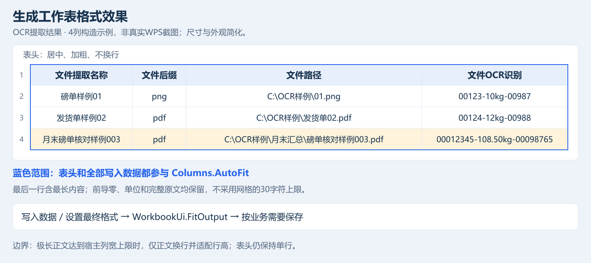

**共享门禁与网站门禁**

门禁条目分两类：**R-xx** 由门禁自动核对（verify_devlog 注册表与重建门禁）；**H-xx** 由人工核对或作为方法指引，不参与自动门禁。除此之外只保留门禁总览表、规则正文与示意图。G 是执行关口，一个 G 可执行多个 R；H 永不映射 G。

# 一. Word与Excel共享门禁

## 1. 文档、编号与经验更新

### (1). 统一重建门禁总览

按表从上到下执行，实际次序、条款与失败语义必须与本表一致；区间写法（如 R-01–R-16）含区间内全部编号；缓存命中保留原检查时间，--skip-ui、缺少 node 等既定跳过须在运行摘要中记录理由。

| 编号   | 门禁              | 执行入口                                                  | 对应条款                          | 失败语义              |
| ---- | --------------- | ----------------------------------------------------- | ----------------------------- | ----------------- |
| G-01 | 六份文档与规则注册表      | devlog_probe→verify_devlog.py                         | R-01–R-16、R-20                | FAIL              |
| G-02 | 公共实现与源引用校验 | verify_shared.py                                      | R-15                          | FAIL              |
| G-03 | 三个 CMD 入口契约     | workflow_probe.py                                     | R-23                          | FAIL              |
| G-04 | 加载项身份预检         | delivery.projects()                                   | R-17                          | FAIL              |
| G-05 | 冗余清理盘点          | cleanup_probe                                         | R-21                          | FAIL              |
| G-06 | 缓存收据核对          | cache_probe                                           | —                             | FAIL              |
| G-07 | 清理审阅            | cleanup_review_probe                                  | R-21                          | FAIL              |
| G-08 | 构建前文档指纹         | input_fingerprint                                     | R-20                          | FAIL              |
| G-09 | 网站快照构建          | site_core.build                                       | R-14                          | FAIL              |
| G-10 | 快照网页门禁          | site_probe --html 快照                                  | R-22                          | FAIL+SKIP(node)   |
| G-11 | Excel 重建链       | C-01/rebuild.py                                       | R-16、R-17、R-18、R-19           | FAIL(HIT 保留原检查时间) |
| G-12 | Excel 后台验证      | C-01/validate.py --background                         | R-17、R-25、R-26、R-27、R-28、R-29 | FAIL              |
| G-13 | Excel 五载荷与内嵌资产  | verify_payload→PayloadProbe.exe                       | R-18、R-24                     | FAIL              |
| G-14 | Word 重建链        | C-02/rebuild.py                                       | R-16、R-17、R-18、R-19           | FAIL(HIT 保留原检查时间) |
| G-15 | Word 后台验证       | C-02/validate.py --background                         | R-17、R-25、R-26、R-27、R-29      | FAIL              |
| G-16 | Word 五载荷与内嵌资产   | verify_payload→PayloadProbe.exe                       | R-18、R-24                     | FAIL              |
| G-17 | 下载页组装与两包核对      | attach_installers+embedded_snapshot+verify_installers | R-24                          | FAIL              |
| G-18 | 下载页网页门禁         | site_probe --html 完整页                                 | R-22                          | FAIL+SKIP(node)   |
| G-19 | 发布前文档指纹         | input_fingerprint                                     | R-20                          | FAIL              |
| G-20 | 事务发布            | delivery.publish                                      | —                             | FAIL(回滚)          |
| G-21 | 发布后布局门禁         | layout_probe.verify（全流程仅一次）                           | R-02                          | FAIL              |
| G-22 | 缓存提交与运行摘要       | build_cache.commit+两份 summary                         | R-20                          | FAIL              |
| G-23 | 收尾独立验证          | bat 末尾 validate.py --background                       | R-01–R-29                     | FAIL              |

**R-01** C-04-Devlog 恰好六份：B0-Entry、A-UserGuide、B1-Project-Files、B2-DevExperience、B3-Gate Control、B4-Code Index；三个项目内不得保留文档副本。仓库根 AGENTS.md 只放指向 B0 的指针，B0 只放阅读顺序与按角色分流。

**R-02** 三个项目只保留 AA-Program（配置器、启动器、正式产物）、AB-Graphic（PNG、SVG、README.txt、.gitkeep）、src 与 build；两个加载项另设 AC-Original Code 专门存放按菜单归类的功能源码，lib 保留必要依赖；AP1-程序、AP2-美工、AP3-说明、icons、src/documentation 出现即失败。

**R-03** 标题最多五级，同级连续编号、新父级重置，编号后一个半角空格；代码围栏内不参与编号。层级为 `# 一.` → `## 1.` → `### (1).` → `#### a.` → `##### i.`，不跳级、不为凑层级拆短句。

**R-04** 顶部只允许一处“最后更新”日期，正文不得出现其他 ISO 日期；B1 必填。

**R-05** B1 四个一级章节；Excel-Iterate 与 WordUpdater 两章各含“版本摘要”，版本四段升序、同章不重复、每行 trim 后不超过 200 字。

**R-06** A-UserGuide 恰好三章，依次为 Excel-Iterate、WordUpdater、XyCabin。

**R-07** B2 四个一级章节；B3 两个一级章节；B4 两个一级章节依次为 Excel-Iterate 与 WordUpdater。

**R-08** 一级章节标题决定范围：含 Excel-Iterate→excel、WordUpdater→word、XyCabin→site；其余必须是登记过的共享标题（B1“Agent及开发者接手概览”、B2“Word与Excel共享开发经验”、B3“Word与Excel共享门禁”）。未知标题或同时命中多个产品即失败。

**R-09** 概览取文档标题与日期之后的首段；A-UserGuide 取一级标题前的导言段，B1 与 B2 取首章后的首段；为空即构建失败。

**R-10** 每个项目档案恰好一处“### (n). 本轮交付证据”；内嵌前整节剔除，B1 共三处。

**R-11** 文档不得出现 HTML 注释，也不再使用 scope、agent-overview、delivery-audit 标记。

**R-12** 文档内本地链接与标题锚点必须可达；审计证据在源码携带时可缺，正式 strict-evidence 要求齐全。

**R-13** 文档图片只允许三个项目 AB-Graphic 下的 PNG、SVG；禁远程地址、绝对路径、越界路径与重解析点。

**R-14** 内嵌资源清单、文档与图片摘要必须与实际字节一致；A-UserGuide 与 B2 各整份内嵌一份，图片按摘要去重。

**R-15** 公共源码和构建实现只在C-00-Shared维护，C-01/C-02经@shared/直接引用；产品仅保留薄入口、专属及生成源码。verify_shared拒绝公共实现副本、缺失或越界引用并核对必要公共二进制依赖；SourceLayoutProbe验证同一公共改动使两产品缓存失效。共享经验在B2、B3各只保留一份。 功能薄入口位于产品AC目录，业务实现不复制；project.json的features与菜单叶子一一对应，feature_index检查实际编译文件、回调唯一性、依赖及B4生成内容，失败不得跳过。

**R-16** 版本唯一来源是各项目配置器的 INSTALLER_VERSION，四段 0～65534，仅用户指定才修改；安装器、加载项与清单同源；新第三段主版本把前一主版本子版本并入末段 0。

**H-01** 维护顺序：对照最终源码→提炼做法、边界、入口、证据→判断归属→更新正文与入口→跑门禁→固定正文重建→回填证据。无新增可迁移经验如实说明，不编造根因。 验收：人工按本节顺序逐步执行。证据：B1 三处交付证据节。

## 2. 重建、签名与交付

**R-17** 链路为配置器（C1-Exceliterate_Configure.py、C2-Wordupdater_Configure.py）→build.py→resign.py→build_installer.py；每次编译后必须重签，csc 的新 MVID 会改变 DLL 摘要。

**R-18** 安装器内嵌主 DLL、Utilities、Office.Core、应用清单、部署清单共五载荷，版本与 DLL、清单一致。

**R-19** 清单保留 customHostSpecified、GAC 依赖与 vstav3/vstov4 结构；ThisAddIn 作为 vstav3 入口，FullTrust 由 VSTO 运行时授予，不在应用清单中声明。未强签依赖不带 token；签后读顶层 identity 重建 vsto 引用，记录 manifest 精确大小与 SHA-256 Base64 摘要；UTF-8 BOM、CRLF。SignCmi 采用 SHA-256，两清单分别有 StrongName 与 Authenticode 签名；ValidateManifest 解析并转储清单结构，ValidateXmlSig 校验整清单及 license 绑定。

### (1). 门禁一致性与构建期保护

**R-20** 实际重建执行的门禁集合、次序与失败语义必须与本文件 一.1(1) 门禁总览表逐项一致：表内门禁缺失且无记录的跳过条件、执行表外门禁或次序不符，均按失败处理。verify_devlog.py 在每次重建预检时核对上一轮 last-run-summary.json 与 validate-run-summary.json；缓存复用保留原检查时间，不声称本轮重测；--skip-ui、缺少 node 等既定跳过条件须在摘要中记录理由。日常 rebuild/validate 显式 `--background`，DialogSizesProbe `--core` 仍必需，完整预览与拖动单列；`--skip-ui` 只跳截图不保证后台。

**H-02** 重建运行期间不得编辑 C-04-Devlog 文档、共享源码与内嵌图片；确需修改，等待本次构建完整结束后再改并重跑。input_fingerprint 在构建前与发布前各取一次，发现构建期间变更即中止发布、保留上轮正式产物，不带着不一致资产交付。 验收：构建前后指纹一致且无编辑。证据：last-run-summary.json 的 G-08/G-19 记录。

**H-03** 信任缺失与签名损坏须分别报告；缺校验器或载荷不符阻止交付。安装需完整 VSTO Runtime 和官方 VSTOInstaller：RuntimeLocator 查 HKLM 两视图及 Common Files，缺少先停止，不释放新载荷、不写信任。用户保存文件并完全退出 WPS 后运行安装器，在官方窗口授权；注销本产品旧订阅成功才替换或重装，真实退出 0 才补 Manifest、LoadBehavior=3、AddinsWL。取消或非零退出如实报告，不静默安装。卸载只清自身订阅、挂载、白名单、信任与载荷，保留 LastInstallDir。 验收：真实环境安装/卸载并记录退出码与载荷状态。证据：SetupLogs 与宿主加载项列表。

**H-04** 排障按“运行库→SetupLogs→五载荷、挂载、白名单、订阅信任→签名摘要→真实宿主”。Manifest 是绝对 file URL 加 `|vstolocal`，codebase 相对；移动目录须重装。同版本不代表同字节，查安装路径与实际加载 DLL 摘要。COMAddIns.Connect 可作连接证据，Object=null、模块扫描或文件释放不能单独定启用。SetupDoctor 在 build，只读诊断不随正式输出交付。 验收：按链路逐层取证后定位。证据：SetupLogs、五载荷校验输出与签名摘要。

## 3. 验证、缓存与证据边界

### (1). 实机 COM 验收

**R-29** 探针边界：离线探针不得连接或启动 WPS；实机探针必须经 LiveProbeSafety 夹具（src/tools/LiveProbeSafety.cs 与对应实机探针）建立会话，自建样本由 Own 托管、逐次 ReleaseComObject、finally 恢复 Visible/DisplayAlerts/ScreenUpdating/EnableEvents，失败保留样本与日志；两项目后台验证各执行一次 LiveProbeSafetyFixture（G-12/G-15）。

**H-05** 实机 COM 验收：实机探针只在自建样本与独立临时目录内读写，不操作用户文档，失败保留样本与日志；真实按钮点击、键入焦点、弹窗外观、鼠标拖动与跨屏 DPI 为人工验收。验收：实机执行读写与还原断言。证据：探针日志与实机记录。

### (2). 弹窗维护规范

**R-25** 交互弹窗样式红线：src/addin 交互弹窗不得出现 TopMost=true、ShowInTaskbar=false、MinimizeBox=false（`WS_EX_TOOLWINDOW` 会在 WPS 宿主线程抢焦点，表现为单元格无法键入、功能区子菜单点不开）；Excel 侧由 DisciplineProbe C 段（交互弹窗白名单）与 TrackerProbe 源码扫描及构造断言核对，Word 侧由 LinkViewFormProbe 同款扫描核对（G-12/G-15）。

**R-26** 弹窗登记完整性：加载项自有 Form 子类必须在 DialogCatalog（DialogSizes、DialogPreviewFactory、dialog_catalog_probe、GridHeadersProbe 链）登记；探针核对 Form 集合与目录键（G-12/G-15）。

**H-06** 弹窗验收必须含真实宿主交互：开窗后键入单元格、展开功能区子菜单、Esc 关闭；后台探针通过不等于焦点与菜单验收。验收：实机执行上述动作。证据：实机操作记录。

## 4. 冗余文件清理

**H-07** 只有用户实际要求“启动冗余清理”才触发盘点或删除；讨论规则、改文档或构建不触发历史清理。默认范围三个项目，另指定从其指令；项目外原图、用户配置、缓存不自动纳入。 验收：仅在用户明确要求时执行。证据：用户指令记录与清理清单。

**H-08** 冗余候选须同时满足：生命周期结束或有有效再生办法；不在现行依赖闭包（含动态加载、资源、文档与证据引用）；独有经验或恢复信息已归并；隔离排除候选后从保留输入无旧 build 重建和适用验证通过。旧日期、old/backup 文件名、build 目录或搜不到引用都不足以证明可删。 验收：逐项核对四条件。证据：cleanup --dry-run 清单与隔离重建日志。

**H-09** 分五类盘点：必要输入、当前产物、有效证据、可删历史、未确认。按实际字节从大到小核对用途与摘要；公共副本职责不同不能因同 SHA 删除；移动项目内不算释放。私钥、`.cer` 证书、必要依赖与未完成恢复资料始终保护，公共 CA 的 `.pem` 不按扩展名误作私钥。 验收：按字节排序逐类核对用途与摘要。证据：schema 3 清单。

**R-21** 执行顺序：记录范围、版本、用途、数量、字节、摘要→归并经验修引用→隔离排除候选完成重建、签名、载荷、资源验证→Website `src/tools/cleanup.py --dry-run` 生成 schema 3 五类清单→逐项审阅→`--apply` 读同一清单复查→复核正式产物与链接并报告实际删除、失败、保留及字节差。清单后的输入或目标变化须重新盘点。网站入口为 `src/tools/cleanup.py --dry-run` 与 `--apply`，范围含三个项目。

**H-10** fixture-state 必须真实结束；cleanup-review 绑定源码指纹、逐文件摘要、用途与经验结论、隔离成功证据及原日志摘要，禁止伪造状态。删除前核绝对路径在指定项目内，不删项目根、不跟随联接、不碰项目外文件；不完整恢复保留。已授权确认项按范围执行。探针成功仅释放自建临时文件，失败保留诊断与恢复资料。 验收：确认 fixture 真实结束且路径在项目内。证据：cleanup-review 摘要与失败保留资料。

## 5. 格式维护规范

### (1). 弹窗中数据网格的格式规范

**R-27** 弹窗网格表头与列宽：生产网格（Excel 11 张、Word 2 张）表头完整单行、居中、默认加粗；用户显式关闭粗体时尊重其选择，字号、字体、颜色与表头文字可自定，但不得因此换行或截断；单行表头高度按实际字体、字号与 DPI 重测，不上下裁剪。列宽下限按表头字体、文字、内边距与排序图标测量，覆盖 Fill、复选、下拉与按钮列；手动缩窄不得低于完整表头宽度，超出窗口以横向滚动查看。文件提取名称正文仍按当前字体 30 个“0”加内边距适配（通常下限 50 逻辑像素），表头更宽时优先表头；新扫描重启适配周期，本周期尊重已手调列宽。两项目 GridHeadersProbe 构造真实生产控件核对，Feature099Probe 默认运行即执行 GridHeaderChecks（G-12/G-15）。

上图为“设置OCR前缀”的离线生产控件渲染：表头完整、单行、居中加粗；非真实 WPS 截图，不作为宿主交互验收证据。

### (2). 程序所新生成工作表的格式规范

**R-28** 程序生成工作表格式（合并抵消报告；普通结果表沿用 WorkbookUi.StyleHeader 浅底深字，不套本节）：首行为合计行，金额列写 `=SUBTOTAL(9,<数据首行>:<工作表末行>)`，Times New Roman 11、套会计格式、垂直居中、不设边框、按默认行高；表头居中、加粗、单行，填充 `#4874CB`、白字、Times New Roman 11，行高保留 26 磅下限，空结果仍显示表头；数据行 Times New Roman 11、不加粗，金额列会计格式 `_ * #,##0.00_ ;_ * \-#,##0.00_ ;_ * "-"??_ ;_ @_ `，垂直居中，备注、调整事项、会计科目列水平居中；表头与数据区边框左缘 medium、内部 slantDashDot，表头顶边 medium，合计行无边框。数据、字体、数字格式与超链接完成后对含表头与全部数据的输出范围 AutoFit（最后一行最长值与隐藏行参与；隐藏行临时显露须在 finally 恢复原 Hidden），超长正文仅对本程序输出区域换行并适配行高，不回写固定列宽。Feature099Probe 默认运行执行 OutputFormatChecks，WorkbookToolsProbe 核对五类输出接线，DisciplineProbe A 段扫“写入后必套样式”（G-12）。

上图为构造示意：表头单行、居中加粗，列宽按表头与全部数据适配；非真实 WPS 截图。[可编辑SVG](../C-01-ExcelIterate/AB-Graphic/output-format-maintenance.svg)

# 二. XyCabin 网站门禁

## 1. 文档、版本与经验归属

**H-11** 网站只维护前端经验（打开、指南、下载、音乐、帮助），不复制宿主公式或字段事务；改指南时核两个宿主是否适用；无新增经验如实说明，不新增维护副本。 验收：人工核对指南仅含前端经验。证据：B2 对应章节。

**R-22** 网站文档直接适用 R-01–R-16；PRODUCTS 版本新到旧，摘要与 B1 对应章节逐字一致，每版 trim 后不超过 200 字，每个功能按 1.、2. 连续编号。

## 2. 验证、编码与缓存

**R-23** 三批处理 UTF-8 无 BOM、CRLF、chcp65001，Python 输出 UTF-8；Windows PowerShell 5 入口避免中文无 BOM 误读。网站末尾中文由 Python 的 ASCII 转义命令输出，子任务后重设 65001；编译诊断按实际编码，不把 GBK 推广至所有入口。

**H-12** 固定图片样例不读取桌面原图。 验收：构建时确认未读取桌面原图。证据：构建输入清单与日志。

## 3. 统一交付与失败恢复

**R-24** 两 DLL 内嵌 WpsShared.Agent.Home.html 必须逐字节相同，移除独立页 installer-assets 后比较网页正文；两个 DLL 含不同宿主业务，不要求 DLL 字节相同。编译只接受空包数据区，防安装包包含自身；网站产品按独立身份映射，不将 Excel 宿主等同 Excel-Iterate 产品。
